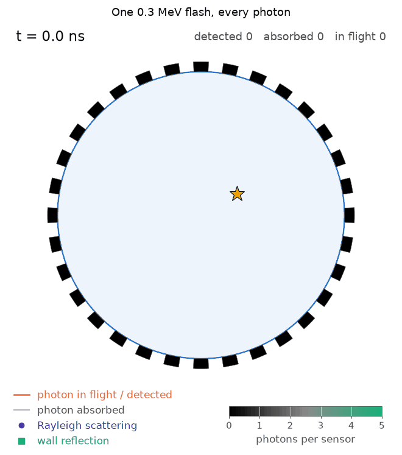
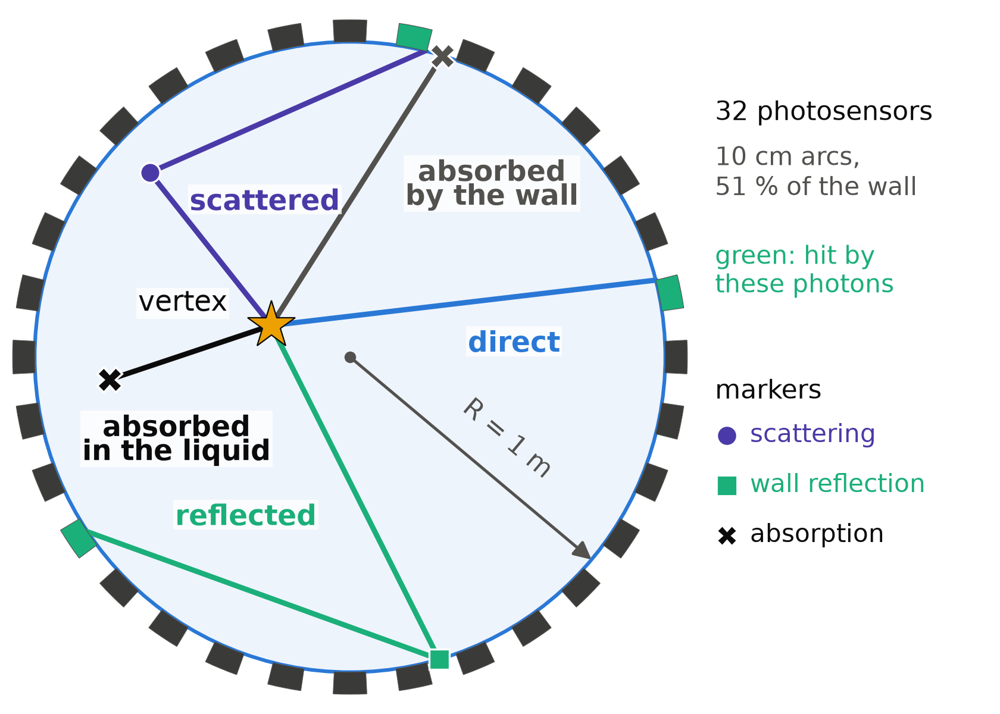

# prob-reco-sbi

[](https://github.com/ArseniiGav/prob-reco-sbi/actions/workflows/ci.yml)
[](https://www.python.org/downloads/)
[](LICENSE)
[](https://github.com/astral-sh/ruff)

**Probabilistic event reconstruction with simulation-based inference** is a course for bachelor students. To
reconstruct an event is to infer where it happened and how much energy it deposited from the response of a detector.
Here the aim is the full posterior distribution of these parameters, not only a best estimate. The course starts with
**A Flash in the Dark**, a photon-transport simulation of a toy two-dimensional scintillation detector with switchable
optical processes. The later stages train neural posterior estimators on its data and then apply them to an open
neutrino-telescope benchmark. This repository holds the simulation package `prob_reco_sbi.flash`, the
one-dimensional normalizing flows `prob_reco_sbi.flows1d`, their documentation and the tasks for the students.

<p align="center">
  
  <br>
  <em>The photons of one event fly out from the vertex at the speed of light in the medium. Scatterings and wall
  reflections appear as markers, absorbed photons turn grey, and detected photons light up their sensor (black: no
  light, green: most light). The event has 0.3 MeV, below the energy range of the default prior, so that its few
  hundred photons can be followed one by one.</em>
</p>

## Course roadmap

| stage | content                                                                                                  | status               |
|-------|----------------------------------------------------------------------------------------------------------|----------------------|
| 1     | **A Flash in the Dark**: the toy detector, its data and the tasks about the data ([TASKS.md](TASKS.md))  | this release (0.1.0) |
| 2a    | **Normalizing flows in one dimension**: the density model of NPE ([TASKS_flows.md](TASKS_flows.md))      | this branch          |
| 2     | Neural posterior estimation (NPE) of the vertex and the energy from the simulated detector response     | next                 |
| 3     | NPE on NuBench, an open benchmark for event reconstruction in neutrino telescopes ([arXiv:2511.13111](https://arxiv.org/abs/2511.13111)) | later |

For background on simulation-based inference, see K. Cranmer, J. Brehmer and G. Louppe,
[The frontier of simulation-based inference](https://doi.org/10.1073/pnas.1912789117),
*Proc. Natl. Acad. Sci. USA* **117**, 30055 (2020).

## The toy detector

<p align="center">
  
</p>

A disc of radius 1 m carries 32 photosensors on its wall. An event at the vertex $(x_0, y_0)$ with the energy $E$ emits
on average 1000 photons per MeV, in random directions, at an unknown time $t_0$. Every photon is tracked until its fate.
On the way it can undergo four processes:

1. **absorption** in the bulk (absorption length 1.5 m);
2. **Rayleigh scattering** in the bulk (scattering length 2 m, phase function $\propto 1 + \cos^2\theta$);
3. **reflection** on the wall between the sensors (probability 0.5, diffuse or specular);
4. **detection** by a sensor, with a Gaussian time jitter of 1 ns.

The first three can be switched off, one by one. For every sensor the detector records the number of hits (the charge),
their mean time and the first time. Reconstructing $(x_0, y_0, E)$ from this response is the inverse problem of the
course. The model, with all equations, is in [docs/physics.md](docs/physics.md).

| parameter                         | default                                              |
|-----------------------------------|------------------------------------------------------|
| detector radius $R$               | 1.0 m                                                |
| sensors                           | 32 arcs of 0.10 m (photocoverage 0.509)              |
| light yield $Y$                   | 1000 photons/MeV, Poisson-distributed photon number  |
| speed of light $c_n$              | 0.2 m/ns                                             |
| absorption length $\lambda_a$     | 1.5 m                                                |
| scattering length $\lambda_s$     | 2.0 m                                                |
| wall reflectivity $\rho$          | 0.5, diffuse (Lambertian)                            |
| detection efficiency, time jitter | 1.0, 1 ns                                            |
| dark noise                        | off (rate per sensor; readout window 100 ns)         |
| prior                             | vertex uniform in the disc; $E$ uniform in [0.5, 5] MeV; $t_0$ uniform in [0, 10] ns |

## Installation

Python 3.10 or newer on Linux, macOS or Windows; a laptop is enough (CPU only, no GPU needed). The environment takes
about 2 GB of disk.

```bash
git clone https://github.com/ArseniiGav/prob-reco-sbi.git
cd prob-reco-sbi
python3 -m venv .venv
source .venv/bin/activate
python -m pip install -e ".[analysis,dev]"
python -m pytest                                 # fast tests (the "deselected" ones are the slow tests)
python -m ipykernel install --user --name prob-reco-sbi --display-name "Python (prob-reco-sbi)"
```

The last line registers the environment as the Jupyter kernel that the notebooks use. In every new terminal, activate
the environment again (`source .venv/bin/activate`), and start JupyterLab from it with `python -m jupyter lab`.

Windows commands, a smaller CPU-only PyTorch, GPU builds, Intel Macs, `uv`, clusters and common problems:
[docs/install.md](docs/install.md).

## Quick start

On the command line (`python -m prob_reco_sbi.flash` works the same way):

```bash
flashsim presets                                        # the physics presets and the default parameters
flashsim generate -n 10000 --seed 1                     # 10 000 events -> data/flash_full_n10000_seed1.h5
flashsim generate --preset straight -n 2000 --seed 2 --save-hits   # straight light, every hit stored
flashsim info data/flash_full_n10000_seed1.h5           # datasets, configuration, provenance
flashsim generate --help                                # every option
```

In Python:

```python
from prob_reco_sbi.flash import generate, load, network_input, preset, save

data = generate(10_000, config=preset("full"), seed=1)  # on the GPU if there is one, else on the CPU
save(data, "data/flash_full.h5")
data = load("data/flash_full.h5")

data.truth.x, data.truth.y, data.truth.energy  # true event parameters, shape [10000]
data.response.charge  # hits per sensor, [10000, 32]
data.response.time_mean  # mean hit time per sensor [ns], NaN for sensors without hits
data.photons.n_detected  # photon bookkeeping per event
x = network_input(data.response.charge, data.response.time_mean)  # network input, [10000, 64]
```

[examples/quickstart.py](examples/quickstart.py) is a complete short script, and
[notebooks/00_quickstart.ipynb](notebooks/00_quickstart.ipynb) a guided first look at the data. A CPU simulates
thousands of events of the default model per second.

## Physics presets and options

The presets form a cumulative physics ladder: each one switches on one more optical process.

| preset           | absorption | scattering | reflection |
|------------------|------------|------------|------------|
| `straight`       | off        | off        | off        |
| `absorb`         | on         | off        | off        |
| `absorb-scatter` | on         | on         | off        |
| `full` (default) | on         | on         | on         |

Every parameter can be changed on top of a preset: on the command line (`--preset straight --reflection --n-sensors
16`) or in Python with the same names (`preset("straight", reflection=True, n_sensors=16)`).

| group     | options of `flashsim generate`                                                                              |
|-----------|-------------------------------------------------------------------------------------------------------------|
| geometry  | `--radius`, `--n-sensors`, `--sensor-width`                                                                 |
| light     | `--light-yield`, `--photon-statistics {poisson,fixed}`, `--speed-of-light`                                  |
| bulk      | `--absorption/--no-absorption`, `--absorption-length`, `--scattering/--no-scattering`, `--scattering-length` |
| wall      | `--reflection/--no-reflection`, `--reflectivity`, `--reflection-model {diffuse,specular}`                   |
| sensors   | `--detection-efficiency`, `--time-jitter`, `--dark-rate` (Hz per sensor), `--readout-window`                |
| prior     | `--r-max`, `--energy-min`, `--energy-max`, `--t0-min`, `--t0-max`, `--fixed-vertex X Y`, `--fixed-energy E` |
| transport | `--max-steps`                                                                                               |
| run       | `--preset`, `-n`, `--seed`, `--device {auto,cpu,cuda}`, `-o`, `--overwrite`, `--save-hits`, `--save-tracks K`, `--track-photons P`, `--first-event-id`, `--photons-per-chunk`, `--threads`, `--no-progress`, `-v`/`-q` |

What each switch does in the simulation is described in [docs/physics.md](docs/physics.md#what-the-switches-do).

## Data format

One HDF5 file per run. The configuration and the provenance (seed, device, versions, creation time, command line) are
stored as attributes of the file.

| group       | content                                                                                     |
|-------------|---------------------------------------------------------------------------------------------|
| `/truth`    | `event_id`, `x`, `y`, `energy`, `t0`                                                        |
| `/response` | `charge`, `time_mean`, `time_first` per event and sensor                                    |
| `/photons`  | photon bookkeeping per event: emitted, detected, absorbed (bulk, wall, sensor), lost; direct, scattered and reflected light; dark noise |
| `/hits`     | optional (`--save-hits`): every hit with its sensor, time, path length and history          |
| `/tracks`   | optional (`--save-tracks K`): photon paths of the first K events                            |
| `/detector` | sensor positions                                                                            |

Types, shapes, units and reading examples are in [docs/data_format.md](docs/data_format.md).

## Tasks

[TASKS.md](TASKS.md) holds the tasks of this stage: set-up (T0), the prior (T1), the detector response (T2), the
physics ladder (T3) and event displays (T4), plus a bonus on the way to inference (T5). The data of T1 to T4 can be
made on any operating system with `python examples/make_task_data.py`.

## Stage 2a: normalizing flows in one dimension

Neural posterior estimation describes the posterior with a normalizing flow. Stage 2a introduces flows where everything
can be drawn and compared with the exact answer: one dimension. The subpackage `prob_reco_sbi.flows1d` (PyTorch,
written from scratch, no new dependencies) has affine, planar, radial and rational-quadratic spline transforms, a
Gaussian and a uniform base, maximum-likelihood training and the exact KL divergence to the target.

- [docs/flows.md](docs/flows.md): the maths, from the change of variables to the transforms and the oracle map, with
  reference figures and animations, and where a one-dimensional flow is used in a real experiment (the NFDE
  likelihood model of [NeuroMCT](https://doi.org/10.1038/s42005-026-02499-6), Commun. Phys. 2026)
- [notebooks/01_flows_1d.ipynb](notebooks/01_flows_1d.ipynb): a guided first look at the package
- [examples/flows_quickstart.py](examples/flows_quickstart.py): one spline fit from the command line, checked against
  the truth (about ten seconds on a CPU; writes `data/flows_quickstart.png`)
- [TASKS_flows.md](TASKS_flows.md): the tasks F1 to F6 and the bonus B1 and B2

```python
from prob_reco_sbi.flows1d import Flow, RQSpline, camel, fit, kl_to_truth

target = camel()  # the target of the tasks: a mixture of three Gaussians
x = target.sample(20_000, seed=11)
flow = Flow([RQSpline(bins=16)])  # a rational-quadratic spline on a standard normal base
fit(flow, x, steps=2000, lr=1e-2)  # maximum likelihood (forward KL) with Adam
print(kl_to_truth(flow, target))  # exact KL divergence to the target, in nats
```

## Development

`python -m pytest` runs the fast tests, `python -m pytest -m slow` the slow ones, and `pre-commit run --all-files` the
lint and format checks (install the hooks once with `pre-commit install`). Continuous integration runs all of this on
Linux (Python 3.10 to 3.14), macOS and Windows. Reproducibility of the simulations: [docs/physics.md](docs/physics.md#random-numbers-and-reproducibility);
clusters: [examples/cluster](examples/cluster/README.md); changes between versions: [CHANGELOG.md](CHANGELOG.md).

## Citation

If you use this material, please cite it as described in [CITATION.cff](CITATION.cff) (GitHub shows it under "Cite
this repository").

## License

[MIT](LICENSE)
