# Normalizing flows in one dimension

Neural posterior estimation (NPE) describes the posterior $p(\theta \mid x)$ with a normalizing flow. Before flows
meet the detector, this page and the package `prob_reco_sbi.flows1d` introduce them where everything can be drawn and
checked against the exact answer: one dimension. It defines the maths that the tasks in
[TASKS_flows.md](../TASKS_flows.md) use; the code follows the same notation.

## The target: a camel with a shoulder

All examples learn the same distribution, a mixture of three Gaussians:

```math
p(x) = 0.30\,\mathcal{N}(x; -2.2, 0.25^2) + 0.50\,\mathcal{N}(x; 0.5, 0.9^2) + 0.20\,\mathcal{N}(x; 3.5, 1.4^2).
```

It has a narrow spike at $-2.2$, a broad hump at $0.5$ and a wide shoulder on the right, which makes the distribution
skewed with a heavy right tail. Its density, its cumulative distribution function (CDF)

```math
F(x) = \sum_k w_k\, \Phi\!\left(\frac{x - \mu_k}{\sigma_k}\right), \qquad
\Phi(t) = \tfrac{1}{2}\left[1 + \operatorname{erf}\!\left(t/\sqrt{2}\right)\right],
```

and therefore its quantile function $F^{-1}$ are known exactly. Its mean is $0.29$, its standard deviation $2.18$
and its entropy $H(p) = -\int p \log p \,\mathrm{d}x = 1.888$ nats.

In the code the parameters are the dictionary `CAMEL`, and any other Gaussian mixture is one line:

```python
from prob_reco_sbi.flows1d import CAMEL, Mixture1D, camel

target = camel()  # the same as Mixture1D(**CAMEL)
twins = Mixture1D(weights=[0.5, 0.5], means=[-1.0, 1.0], stds=[0.3, 0.3])
x = target.sample(20_000, seed=11)  # float64 tensor; the samples of the tasks
target.pdf(x), target.log_pdf(x), target.cdf(x), target.quantile([0.1, 0.5, 0.9]), target.entropy()
```

`cdf` is computed as $\tfrac12 \operatorname{erfc}(-t/\sqrt2)$, which equals $\Phi(t)$ but keeps its precision in
the left tail, where $1 + \operatorname{erf}(t/\sqrt2)$ rounds to zero; `sf` gives $1 - F(x)$ with the same precision
in the right tail. `quantile` inverts the CDF by bisection.

## Change of variables in one dimension

A flow is a strictly increasing, differentiable map $z = f(x)$ of the real line together with a base distribution
$p_Z$, usually $\mathcal{N}(0, 1)$. It defines the density $q(x)$ of $x = f^{-1}(z)$ for $z \sim p_Z$. Because $f$
is increasing, $x \le a$ exactly when $z \le f(a)$, so the CDFs agree, $F_q(a) = F_Z(f(a))$, and differentiating in
$a$ gives

```math
q(x) = p_Z\big(f(x)\big)\, f'(x), \qquad \log q(x) = \log p_Z\big(f(x)\big) + \log f'(x).
```

The factor $f'(x)$ accounts for the stretching of the axis: where the map compresses an interval of $x$ into a small
interval of $z$ ($f' < 1$), the density of $x$ is lower than that of $z$, and the other way round. A decreasing map
works too, with $|f'(x)|$; the transforms here are all increasing.

A flow stacks $L$ simple layers, $f = f_L \circ \dots \circ f_1$. With $z_0 = x$ and $z_l = f_l(z_{l-1})$, the chain
rule turns the derivative into a sum of logarithms:

```math
\log q(x) = \log p_Z(z_L) + \sum_{l=1}^{L} \log f_l'(z_{l-1}).
```

This is why every transform in the package returns its output together with $\log |\mathrm{d}z/\mathrm{d}x|$:

```python
z, logdet = transform(x)  # one layer
x = transform.inverse(z)
z, logdet = flow(x)  # all layers, logdet summed
log_q = flow.log_prob(x)  # log p_Z(z) + logdet
```

Sampling runs the map backwards: draw $z \sim p_Z$ and return $x = f^{-1}(z) = f_1^{-1}(\dots f_L^{-1}(z))$
(`flow.sample(n, seed=...)`). A flow is therefore useful when both directions are cheap: the forward map for the
density, the inverse for samples. `flow.transform_points(x)` returns the positions $z_0, z_1, \dots, z_L$ of a set of
points after every layer, the "transport" of the samples from $p$ to the base.

## Training: maximum likelihood is the forward KL divergence

The flow is trained on samples $x_1, \dots, x_N$ of the target by maximising their likelihood, i.e. by minimising the
mean negative log-likelihood

```math
\mathcal{L}(\phi) = -\frac{1}{N} \sum_{i=1}^{N} \log q_\phi(x_i),
```

where $\phi$ are the parameters of all layers. For many samples the average becomes an expectation over $p$:

```math
\mathcal{L}(\phi) \;\to\; \mathbb{E}_{p}\left[-\log q_\phi(x)\right]
  = \underbrace{-\int p \log p \,\mathrm{d}x}_{H(p)}
  + \underbrace{\int p(x) \log \frac{p(x)}{q_\phi(x)} \,\mathrm{d}x}_{\mathrm{KL}(p\,\|\,q_\phi)} .
```

The entropy $H(p)$ does not depend on the flow, so maximum likelihood minimises the forward Kullback-Leibler
divergence $\mathrm{KL}(p \,\|\, q)$. Two consequences:

- the expected loss cannot go below $H(p)$ (1.888 nats for the camel). The training loss itself is an average over
  $N$ samples: it fluctuates around $H(p) + \mathrm{KL}$ by about $\operatorname{std}(\log p)/\sqrt{N}$ (0.006 nats
  for $N = 20\,000$), so it can end below $H(p)$ by chance, and it does so systematically when the flow overfits,
  i.e. learns the particular samples rather than $p$. To estimate the KL divergence from the loss, subtract the loss
  of the exact density on the same samples, $-\frac{1}{N}\sum_i \log p(x_i)$, rather than $H(p)$: most of the
  fluctuation is then the same in both terms and cancels. On the training samples this estimate is still biased low,
  because the flow was fitted to them; on held-out samples (`split`, `x_val`) it is not;
- the forward KL weighs the mismatch by $p$: wherever the target has mass and the model has almost none,
  $\log(p/q)$ is large, so the model is pushed to cover all of the target's mass.

The loss needs samples of $p$ and nothing else: never the value of $p(x)$. This is exactly the situation of
simulation-based inference, where the simulator produces samples $(\theta, x)$ but no density, and it is the training
that NPE uses. The reverse divergence $\mathrm{KL}(q \,\|\, p) = \mathbb{E}_q[\log q - \log p]$, used in variational
inference, needs $\log p$ at the model's samples, which a simulator cannot provide (for NPE, $p$ would be the unknown
posterior itself); it is not used in this course.

The package's `fit` is this loop with the Adam optimiser:

```python
from prob_reco_sbi.flows1d import Flow, RQSpline, fit

flow = Flow([RQSpline(bins=16)])
history = fit(flow, x, steps=2000, lr=1e-2)  # full batch by default; batch=256 for mini-batches
history.loss, history.train_loss, history.step  # loss per update; full training loss at the snapshots
```

`fit` takes a snapshot every `every` updates (10 by default): the loss on the training samples and, if given, on
validation samples (`x_val`, never used for the updates; `split` makes such a split), a copy of all parameters, and the
model density $q$ and the map $f$ on a grid of $x$ values (`grid`): the frames of a training animation.
`history.restore(flow, i)` loads snapshot `i` back into the flow.

## The transforms

All parameters of a transform are unconstrained real numbers; the transform maps them into the region where $f$ is
strictly increasing, so (in exact arithmetic) no gradient step can produce a map that is not invertible. The
parameter count is `transform.n_params`, and `flow.n_params` for a whole flow.

| transform | $z = f(x)$ | parameters | strictly increasing if | inverse |
|---|---|---|---|---|
| `Affine` | $e^{s} x + t$ | 2 | always | exact |
| `Planar` | $x + \hat u \tanh(w x + b)$ | 3 | $\hat u w > -1$ | bisection |
| `Radial` | $x + \hat\beta\,\dfrac{x - x_0}{\hat\alpha + \lvert x - x_0 \rvert}$ | 3 | $\hat\alpha > 0$, $\hat\beta > -\hat\alpha$ | bisection |
| `RQSpline` | rational-quadratic on $K$ bins in $[-B, B]$, identity outside | $3K - 1$ | by construction | exact |
| `Sigmoid` | $1/(1 + e^{-x})$ | 0 | always | exact |

### Affine

```math
z = e^{s} x + t, \qquad \log \frac{\mathrm{d}z}{\mathrm{d}x} = s .
```

The scale $e^{s}$ is positive for every $s$. An affine flow with a standard normal base is the Gaussian
$\mathcal{N}(-t e^{-s}, e^{-2s})$: it can move and stretch the base, but not change its shape.

### Planar (Rezende and Mohamed, 2015)

```math
z = x + \hat u \tanh(w x + b), \qquad
\frac{\mathrm{d}z}{\mathrm{d}x} = 1 + \hat u w \left[1 - \tanh^2(w x + b)\right].
```

The map is the identity plus a smooth step of total height $2\hat u$, centred at $x = -b/w$ and about $1/|w|$ wide.
Since $1 - \tanh^2$ takes every value in $(0, 1]$, the derivative is positive everywhere if and only if
$\hat u w > -1$. The paper enforces this by replacing the raw parameter $u$ with

```math
\hat u = u + \big[m(w u) - w u\big] \frac{w}{w^2}, \qquad m(a) = -1 + \log(1 + e^{a}),
```

so that $\hat u w = m(w u) > -1$ for all $u$ and $w$. Parameters: $u, w, b$. There is no closed-form inverse, but
$|z - x| = |\hat u \tanh(\cdot)| < |\hat u|$, so the solution of $f(x) = z$ lies in $[z - |\hat u|, z + |\hat u|]$,
and bisection on this bracket finds it to machine precision (`invert_monotone`). With `Planar(constrained=False)` the
raw $u$ is used directly, which shows what happens when the condition is violated.

`Planar()` starts from $w, b \sim \mathcal{N}(0, 1)$ and a small raw $u \sim \mathcal{N}(0, 0.1^2)$. A small $u$ does
not mean a small $\hat u$: for $u \to 0$, $\hat u w \to m(0) = \log 2 - 1 \approx -0.31$, so $\hat u \approx -0.31/w$,
and a layer whose $w$ starts close to 0 starts as a large shift. A deep stack can therefore start far from the data,
which is one reason why the result of a deep planar stack depends on its initial parameters. A start at
$u = w = b = 0$ does not work at all: there $\hat u = 0$ and every gradient vanishes.

### Radial (Rezende and Mohamed, 2015)

```math
z = x + \hat\beta\, \frac{x - x_0}{\hat\alpha + |x - x_0|}, \qquad
\frac{\mathrm{d}z}{\mathrm{d}x} = 1 + \frac{\hat\alpha \hat\beta}{(\hat\alpha + |x - x_0|)^2} .
```

The map pushes points away from the centre $x_0$ ($\hat\beta > 0$) or pulls them towards it ($\hat\beta < 0$), within a
distance of about $\hat\alpha$; far away it is a shift by $\pm\hat\beta$. At $x = x_0$ the derivative equals
$1 + \hat\beta/\hat\alpha$; for $\hat\beta < 0$ this is its smallest value (for $\hat\beta > 0$ its largest, and the
derivative is above 1 everywhere), so the derivative is positive everywhere if and only if $\hat\beta > -\hat\alpha$.
The raw parameters $\alpha, \beta$ are mapped to

```math
\hat\alpha = \log(1 + e^{\alpha}) > 0, \qquad \hat\beta = -\hat\alpha + \log(1 + e^{\beta}) > -\hat\alpha .
```

Parameters: $x_0, \alpha, \beta$. The inverse is found by bisection in $[z - |\hat\beta|, z + |\hat\beta|]$, since
$|z - x| < |\hat\beta|$. `Radial(constrained=False)` uses the raw $\beta$.

In more than one dimension both transforms have a cheap determinant of the Jacobian but a very limited form (a
planar layer changes the density along one direction, a radial layer around one point); they are the historical
starting point of normalizing flows.

### Rational-quadratic spline (Durkan et al., 2019)

The interval $[-B, B]$ is cut into $K$ bins by the knots $(x_k, y_k)$, $k = 0, \dots, K$, with
$x_0 = y_0 = -B$ and $x_K = y_K = B$, and the spline has positive derivatives $d_k$ at the knots. In bin $k$, with
width $w_k = x_{k+1} - x_k$, height $h_k = y_{k+1} - y_k$, slope $s_k = h_k / w_k$ and the position
$\xi = (x - x_k)/w_k \in [0, 1]$:

```math
z = y_k + \frac{h_k \left[s_k \xi^2 + d_k \xi (1 - \xi)\right]}{s_k + (d_k + d_{k+1} - 2 s_k)\, \xi (1 - \xi)},
```

```math
\frac{\mathrm{d}z}{\mathrm{d}x} = \frac{s_k^2 \left[d_{k+1} \xi^2 + 2 s_k \xi (1 - \xi) + d_k (1 - \xi)^2\right]}
{\left[s_k + (d_k + d_{k+1} - 2 s_k)\, \xi (1 - \xi)\right]^2} .
```

The spline passes through every knot with slope $d_k$, and every term of the derivative is positive when $w_k$,
$h_k$ and $d_k$ are: the map is strictly increasing by construction, whatever the parameters. The raw parameters
are $K$ widths and $K$ heights, turned into positive bin sizes that add up to $2B$ by a softmax (with a minimum share
of $10^{-3}$ per bin), and the $K - 1$ interior derivatives, made positive by $d = 10^{-3} + \log(1 + e^{a})$. The
end derivatives are fixed, $d_0 = d_K = 1$, so that the spline joins the identity outside $[-B, B]$ smoothly: in
total $3K - 1$ parameters.[^identifiable] The tails beyond $\pm B$ are not learned at all, which is why the bound
matters (`RQSpline(bins=16, bound=10.0)` by default).

[^identifiable]: Two of them are redundant: adding the same constant to all $K$ width parameters, or to all $K$
    height parameters, does not change the softmax, so only $3K - 3$ combinations change the map. `n_params`
    counts all $3K - 1$.

The inverse is exact: for $z$ in bin $k$, $\xi$ is the root in $[0, 1]$ of $a \xi^2 + b \xi + c = 0$ with

```math
a = h_k (s_k - d_k) + (z - y_k)(d_{k+1} + d_k - 2 s_k), \quad
b = h_k d_k - (z - y_k)(d_{k+1} + d_k - 2 s_k), \quad
c = -s_k (z - y_k),
```

```math
\xi = \frac{2c}{-b - \sqrt{b^2 - 4ac}}, \qquad x = x_k + \xi w_k .
```

A newly created spline is the identity (equal bins, unit derivatives). `spline.knots()` returns $x_k$, $y_k$ and
$d_k$ for drawing.

## The base: Gaussian or uniform

The base is `StandardNormal()` by default. The alternative `Uniform()` is the uniform distribution on $(0, 1)$, with
$\log p_U(u) = 0$ inside and $-\infty$ outside. A flow with this base ends with a layer that maps the real line onto
$(0, 1)$; the package's is the logistic function:

```math
u = \sigma(y) = \frac{1}{1 + e^{-y}}, \qquad
\log \frac{\mathrm{d}u}{\mathrm{d}y} = \log \sigma(y) + \log\big(1 - \sigma(y)\big), \qquad
y = \sigma^{-1}(u) = \log \frac{u}{1 - u} ,
```

```python
from prob_reco_sbi.flows1d import Flow, RQSpline, Sigmoid, Uniform

flow = Flow([RQSpline(bins=16), Sigmoid()], Uniform())
```

When sampling, $u$ is clipped to $[\epsilon, 1 - \epsilon]$ with the machine precision $\epsilon$ of the flow's
floating-point type, so that the logit stays finite.

## The oracle map: the exact answer in one dimension

For a continuous target with CDF $F$, the random variable $U = F(X)$ is uniform on $(0, 1)$: for
$X \sim p$, $P(F(X) \le u) = P(X \le F^{-1}(u)) = F(F^{-1}(u)) = u$ (the probability integral transform). Applying the
standard normal quantile function then gives a standard normal variable. Hence the exact flows of the target are

```math
z = \Phi^{-1}\big(F(x)\big) \;\;\text{(Gaussian base)}, \qquad u = F(x) \;\;\text{(uniform base)},
```

with the log-derivatives $\log p(x) - \log \varphi(z)$ and $\log p(x)$, where $\varphi$ is the standard normal
density. Run backwards, $x = F^{-1}(u)$ with $u \sim \mathcal{U}(0, 1)$ is inverse-transform sampling: sampling from
a flow is exactly this, with a learned map in place of $F^{-1}$.

`oracle_map(target, base)` returns this map as a transform, so that `Flow([oracle_map(target)])` has $q = p$ to
machine precision and the learned map of any flow can be drawn next to the exact one. In the right tail, where
$F(x)$ rounds to 1, the map is computed as $z = -\Phi^{-1}(1 - F(x))$ from the survival function.

One dimension is special because this map is unique: a strictly increasing map that turns $p$ into the base is
fixed by $F_Z(f(x)) = F(x)$, i.e. $f = F_Z^{-1} \circ F$. Every increasing flow that fits the target well must
therefore approximate one and the same curve, and the difference between the learned and the oracle map shows where
the fit is wrong. In two or more dimensions infinitely many maps push $p$ onto a standard normal (compose any one of
them with a rotation of the base), and no single "correct" map exists to compare with.

## Measuring the fit

**KL divergence by quadrature.** In one dimension the forward KL divergence is an ordinary integral, evaluated by
`kl_to_truth(flow, target)` with the trapezoidal rule on 20 001 points between $\min_k(\mu_k - 10\sigma_k)$ and
$\max_k(\mu_k + 10\sigma_k)$:

```math
\mathrm{KL}(p \,\|\, q) = \int p(x) \left[\log p(x) - \log q(x)\right] \mathrm{d}x \;\ge\; 0 ,
```

in nats, zero only for $q = p$. It is the quantity that training minimises, but computed exactly instead of estimated
from samples, so it is the truth metric of every comparison: depth, number of bins, base, sample size. The flow is
evaluated on a float64 copy, so the result does not suffer from the float32 rounding of the training. If the model
puts zero density where the target has mass, the divergence is infinite.

**Gaussianized samples.** If the flow is right, $z = f(x)$ of target samples follows the base. Two standard checks
compare samples with a distribution: `qq_points(z)` returns the base quantiles and the sample quantiles at the same
probabilities (a quantile-quantile plot is on the diagonal for a perfect fit), and `ks_statistic(z)` returns the
Kolmogorov-Smirnov distance $D = \max_x |F_N(x) - \Phi(x)|$ between the empirical CDF $F_N$ and the base CDF, with
its asymptotic p-value. Both accept any reference with a `cdf` or `quantile` method: `StandardNormal()`,
`Uniform()` or a target. For the oracle map the p-value is uniformly distributed between 0 and 1, as for any exact
model; for a learned flow and many samples, the test eventually detects every imperfection, which is why the KL
divergence, not the p-value, measures how good a flow is.

## Where this is used: a one-dimensional flow in a real experiment

Everything above is the toolbox of a real analysis. In the JUNO neutrino experiment the energy response of the
detector depends on three parameters $\boldsymbol\psi$ (Birks' coefficient, the Cherenkov yield factor and the light
yield), and the data that constrain them are the spectra of calibration sources: for each source, the number of
photo-electrons $x$ of every event. The likelihood $p(x \mid \boldsymbol\psi)$ has no closed form, since it comes out
of a full detector simulation, so it is learned: the NFDE model of the NeuroMCT paper (Gavrikov et al. 2026) is a
*conditional* one-dimensional normalizing flow $z = f(x, \boldsymbol\psi)$ with a standard normal base,
trained by maximum likelihood on simulated events, exactly as in this stage, but with the parameters as an extra
input. This is neural likelihood estimation (NLE): the flow gives the likelihood of the calibration data, and
combined with a prior and sampled over $\boldsymbol\psi$, it gives the posterior of the response parameters. Bonus
task B2 is the toy version of it.

<p align="center">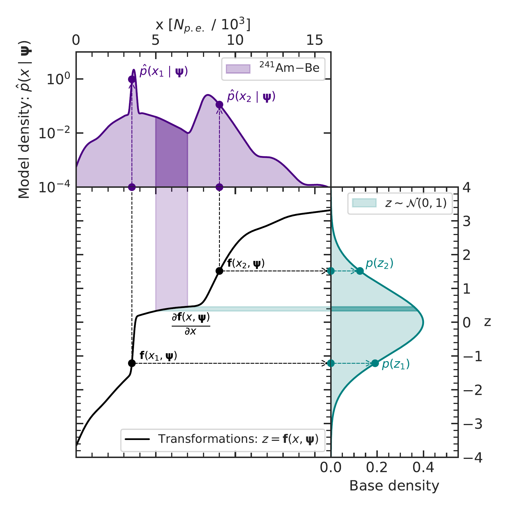</p>

**The change of variables at work.** The learned map $f(x, \boldsymbol\psi)$ (black) sends the
${}^{241}$Am-Be spectrum (top, log scale, with its narrow line and its broad continuum) to $z \sim \mathcal N(0, 1)$
(right); the model density is
$\hat p(x \mid \boldsymbol\psi) = \varphi(f(x, \boldsymbol\psi))\,|\partial f / \partial x|$, the formula of the
section on the change of variables. Compare with the oracle map of the camel above: a narrow line is a steep piece of
the map, a continuum a shallow one.

<p align="center">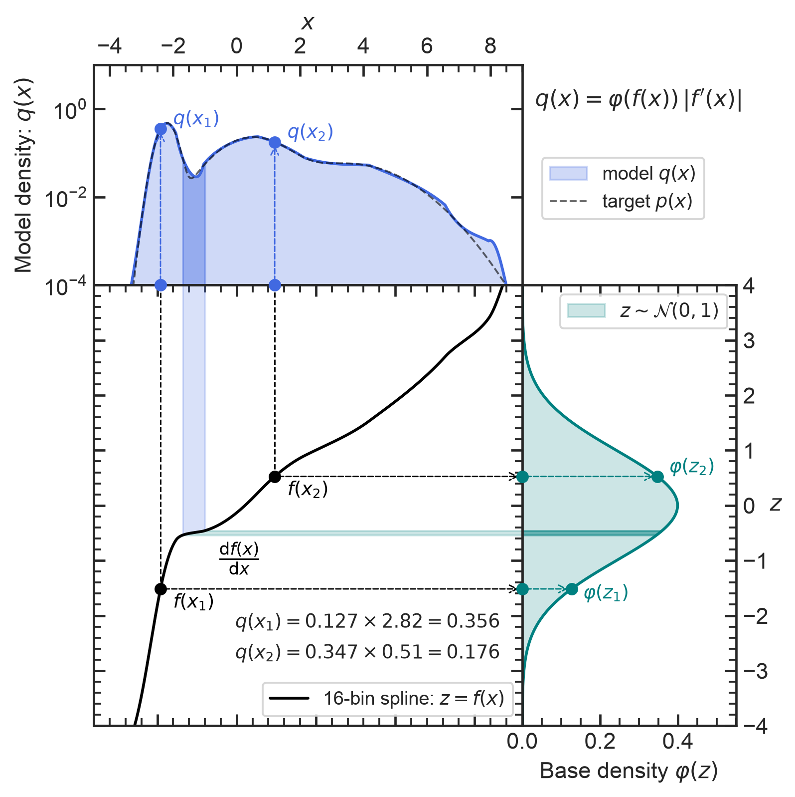</p>

**The same picture on the camel.** A 16-bin spline fitted to the 20 000 samples of the camel: its density on top (the
target dashed), the map $z = f(x)$ in the centre and the base on the right. On the left flank of the spike, at
$x_1 = -2.4$, the map is steep and $q(x_1) = \varphi(z_1)\,f'(x_1) = 0.127 \times 2.82 = 0.356$; on the right flank of
the hump, at $x_2 = 1.2$, it is shallow and $q(x_2) = 0.347 \times 0.51 = 0.176$. Between the spike and the hump the map
is almost flat: the slab $x \in [-1.7, -1.0]$ is squeezed into $\Delta z = 0.08$, and the model gives it the same
probability, 2.9 %, on both axes.

<p align="center">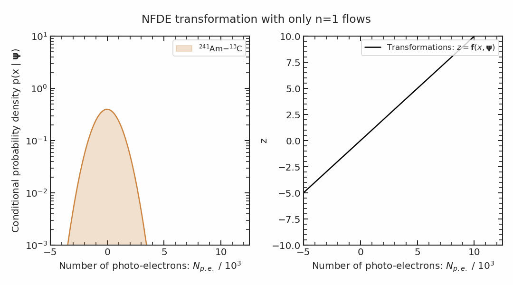</p>

**Building a spectrum layer by layer.** The flow of NeuroMCT is a composition of transformations, like the stacks of
this stage; the animation shows the model density of the ${}^{241}$Am-${}^{13}$C source taking shape as the
transformations are applied one after the other.

<p align="center">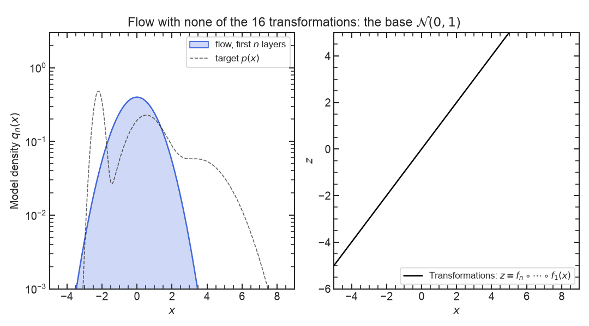</p>

**The same picture on the camel.** A stack of 16 planar layers fitted to the camel, with only its first $n$ layers in
frame $n$: the density $q_n(x) = \varphi(f_n \circ \dots \circ f_1(x)) \prod_{k \le n} f_k'$ and the map, from the base
($n = 0$) to the full model ($n = 16$); the dashed target is our addition to the picture of the paper. Every $q_n$ is a
proper density, but the frames do not approach the camel step by step: after 9 layers the spike is almost three times
too high (1.36), the 10th layer, nearly a constant shift, moves the mass to the right, and only the last layers put it
in place. Training fits the composition, not the intermediate stages.

<p align="center">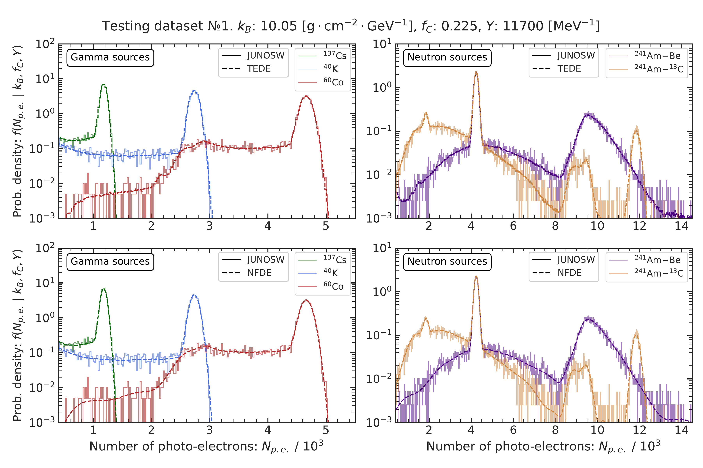</p>

**What a one-dimensional flow achieves.** The learned densities (dashed, bottom row: NFDE) on top of the simulated
spectra of three gamma and two neutron sources at one point $\boldsymbol\psi$ of the parameter space, over three
orders of magnitude; the top row is the binned alternative of the same paper (TEDE).

**Figure credit.** The three NeuroMCT figures above are reproduced from the authors' code repository,
[github.com/ArseniiGav/NeuroMCT](https://github.com/ArseniiGav/NeuroMCT), © 2025 Arsenii Gavrikov, Andrea Serafini
and Dmitry Dolzhikov, where they are distributed under the MIT licence, which also covers their use in this
repository. Versions of two of them appear in A. Gavrikov et al., *Commun. Phys.* **9**, 63 (2026),
[doi:10.1038/s42005-026-02499-6](https://doi.org/10.1038/s42005-026-02499-6), an open-access article published under
the Creative Commons Attribution-NonCommercial-NoDerivatives 4.0 International licence
([CC BY-NC-ND 4.0](https://creativecommons.org/licenses/by-nc-nd/4.0/)): whoever reuses the published versions must
credit the article, may not use them commercially and may not distribute modified versions. The "same picture on
the camel" figures are new figures of this course and carry its MIT licence.

<p align="center">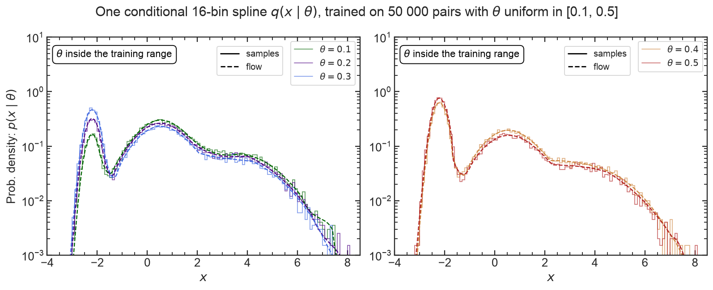</p>

**The same picture on the camel.** The family of bonus task B2, $p(x \mid \theta)$ with $\theta$ the weight of the spike
($\theta = 0.3$ is the camel), learned by one conditional flow: a 16-bin spline whose 47 parameters are the output of a
small network of $\theta$, trained by maximum likelihood on 50 000 pairs with $\theta$ uniform in [0.1, 0.5]. Histograms
of 20 000 fresh samples per $\theta$ and the flow (dashed), over three orders of magnitude: one network, five
"sources" that differ only in the weight of the spike. What the same flow says for a $\theta$ outside its training
range is the question of bonus task B2.

## Package overview

| module | contents |
|---|---|
| `targets` | `Mixture1D` (pdf, log_pdf, cdf, sf, quantile, sample, entropy), `CAMEL`, `camel()`, `oracle_map`, `OracleMap` |
| `transforms` | `Transform`, `Affine`, `Planar`, `Radial`, `RQSpline`, `Sigmoid`, `invert_monotone` |
| `flow` | `Flow` (forward, log_prob, inverse, sample, transform_points, n_params), `StandardNormal`, `Uniform` |
| `train` | `fit` (maximum likelihood with Adam), `History`, `split` |
| `diagnostics` | `kl_to_truth`, `qq_points`, `ks_statistic` |

Everything is imported from `prob_reco_sbi.flows1d`. A complete fit:

```python
import torch
from prob_reco_sbi.flows1d import Flow, Planar, camel, fit, kl_to_truth, oracle_map

target = camel()
x = target.sample(20_000, seed=11)
torch.manual_seed(0)  # initial parameters of the planar layers: the result depends on this seed, try a few
flow = Flow([Planar() for _ in range(8)])
history = fit(flow, x, steps=2000, lr=1e-2, grid=torch.linspace(-5, 9, 400))
print(flow.n_params, kl_to_truth(flow, target))  # 24 parameters, KL in nats
z_learned = flow(x)[0].detach()
z_exact, _ = oracle_map(target)(x)
```

A 16-bin spline trained with 2000 full-batch Adam steps on 20 000 samples takes a few seconds on a CPU.

## References

- D. J. Rezende and S. Mohamed, "Variational inference with normalizing flows", ICML 2015, arXiv:1505.05770.
- C. Durkan, A. Bekasov, I. Murray and G. Papamakarios, "Neural spline flows", NeurIPS 2019, arXiv:1906.04032.
- G. Papamakarios, E. Nalisnick, D. J. Rezende, S. Mohamed and B. Lakshminarayanan, "Normalizing flows for
  probabilistic modeling and inference", J. Mach. Learn. Res. 22(57) (2021) 1-64, arXiv:1912.02762.
- A. Gavrikov, A. Serafini, D. Dolzhikov, A. Garfagnini, M. Gonchar, M. Grassi et al. (JUNO-Italia Consortium),
  "Simulation-based inference for precision neutrino physics through neural Monte Carlo tuning", Commun. Phys. 9,
  63 (2026), doi:10.1038/s42005-026-02499-6; code: github.com/ArseniiGav/NeuroMCT.

## Figures

The reference figures of this page; the tasks ask for your own versions. Every flow in them was trained with `fit`
on 20 000 samples of the target drawn with `seed=1` (the tasks use `seed=11`), with 2000 full-batch Adam steps and a
learning rate of 0.01.

<p align="center">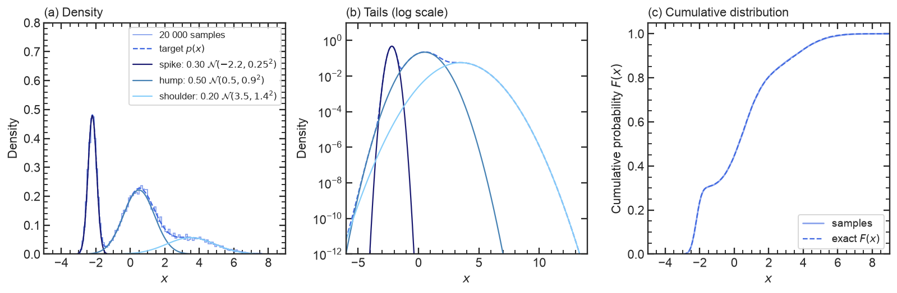</p>

**The target.** The density of the camel with its three components and a histogram of 20 000 samples, the same on a
logarithmic scale (the spike falls off fastest, the shoulder makes the right tail heavy), and the exact CDF on top of
the empirical one.

<p align="center">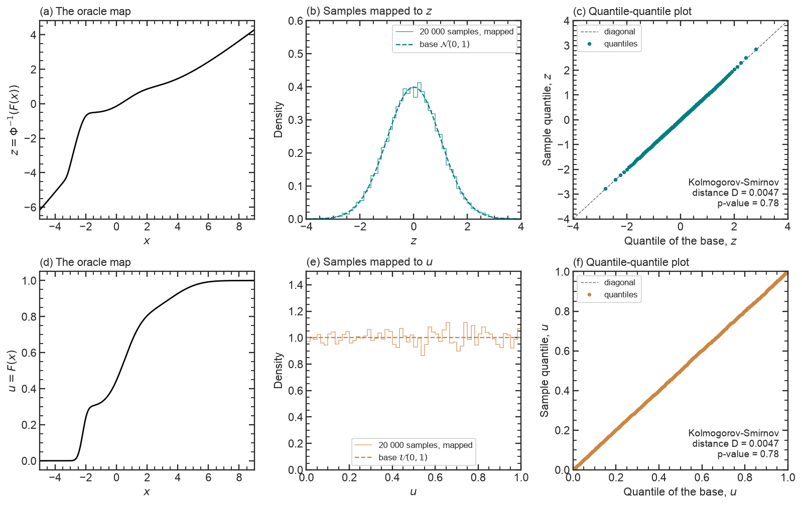</p>

**The oracle map.** The exact flow turns the 20 000 samples into draws from the base, $z = \Phi^{-1}(F(x))$ for the
Gaussian base (top) and $u = F(x)$ for the uniform base (bottom): the maps, the histograms of the mapped samples, and
the quantile-quantile plots with the Kolmogorov-Smirnov test against the base.

<p align="center">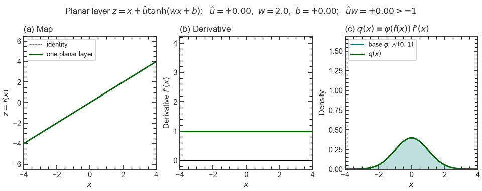</p>

**One planar layer.** As $\hat u w$ runs from $-0.95$ to $3$ and then the centre $-b/w$ moves (with $w = 2$), the map
bends into a smooth step and its derivative into a bump or a dip; the right panel shows the density
$\varphi(f(x))\,f'(x)$ of a flow made of this one layer.

<p align="center">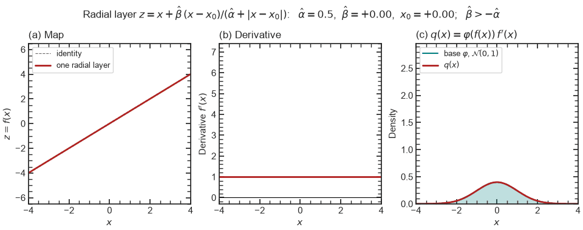</p>

**One radial layer.** With $\hat\alpha = 0.5$, the strength $\hat\beta$ runs from $-0.48$ to $3$ and then the centre
$x_0$ moves between $-2$ and $2$: the layer pushes points away from $x_0$ or pulls them in, and the panels show the
map, its derivative, which equals $1 + \hat\beta/\hat\alpha$ at $x_0$, and the density of a flow made of this one
layer.

<p align="center">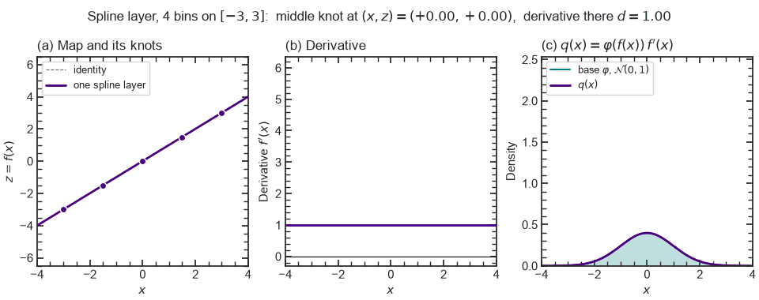</p>

**One spline bin.** In a 4-bin spline on $[-3, 3]$ the middle knot moves up and down by 1.8 (the other two interior
knots share the change), then its derivative changes from 0.15 to 6, which reshapes only the two bins next to it, and
then the knot moves sideways; the map stays increasing whatever the values and is the identity outside $[-3, 3]$.

<p align="center">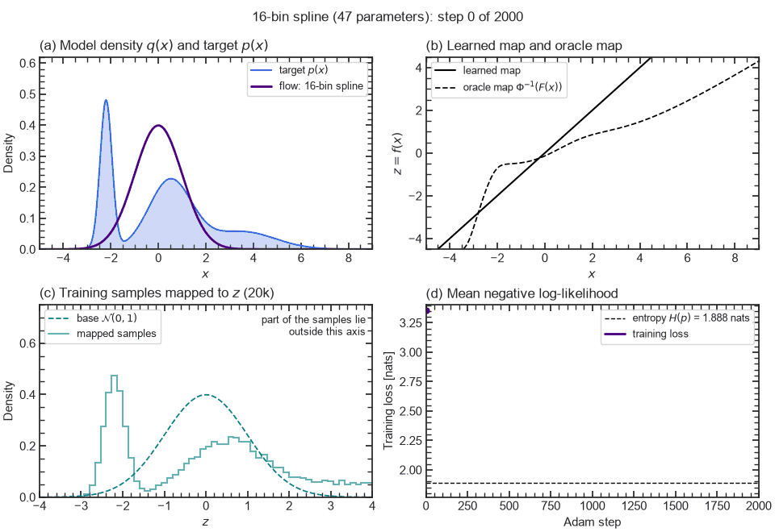</p>

**Training a 16-bin spline (47 parameters).** One frame per 10 Adam steps: the model density against the target, the
learned map against the oracle map, the training samples mapped to $z$ against $\mathcal{N}(0, 1)$, and the training
loss with the entropy $H(p)$ for reference.
