# Neural posterior estimation

Neural posterior estimation (NPE) trains a normalizing flow on simulated events and then returns the posterior of the
event parameters for any observed event. This page defines the maths that the tasks in
[tasks/stage2b_npe/](../tasks/stage2b_npe/README.md) use, with the package `prob_reco_sbi.npe`; the code follows the
same notation. It builds on the flows in one dimension of [flows.md](flows.md).

<p align="center">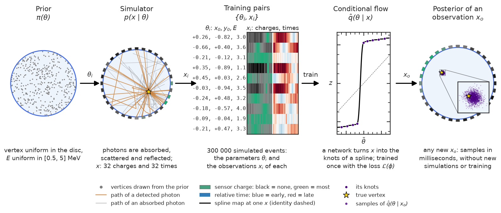</p>

**The idea.** Parameters drawn from the prior go through the simulator; the pairs $\lbrace \theta_i, x_i \rbrace$
train a conditional flow; the trained flow gives the posterior of any observation $x_o$, without new simulations.

## Notation

"Guide" is the practical guide to simulation-based inference of Deistler et al. (2025), "paper" the NeuroMCT paper of
Gavrikov et al. (2026); see the [references](#references).

| symbol | meaning | from |
|---|---|---|
| $\theta = (x_0, y_0, E)$ | the event parameters, to be inferred | stage 1; guide |
| $x$ | the observations: what the network is given for one event | guide; paper |
| $x_o$ | the observed event whose posterior is asked | guide |
| $\pi(\theta)$ | the prior | paper; the guide writes $p(\theta)$ |
| $p(x \mid \theta)$ | the likelihood, known in general only through the simulator | guide; paper |
| $\mathcal{L}(x \mid \theta)$ | the likelihood as a function of $\theta$, where it has a formula | paper |
| $\kappa_j(x_0, y_0)$, $\kappa = \sum_j \kappa_j$ | probability that a photon from the vertex is detected by sensor $j$; the light collection | new; stage 1 wrote $Q/(Y E)$ |
| $\mu_j = Y E\, \kappa_j$ | the expected charge of sensor $j$ | paper (expected counts) |
| $q(\theta \mid x)$ | the posterior, $q(\theta \mid x) \propto \mathcal{L}(x \mid \theta)\, \pi(\theta)$ | paper |
| $\hat q(\theta \mid x)$ | the posterior estimated by the network; the hat marks a learned density | paper; the guide's $q_\phi(\theta \mid x)$ |
| $\phi$ | the parameters of the network | guide |
| $f_\phi$ | the transformation of the flow in the normalizing direction, $z = f_\phi(\theta \mid x)$ | 2a |
| $z$, $p_Z$ | the base variable and the base density, the standard normal | 2a; paper |
| normalizing, generative direction | from $\theta$ to $z$ (the density), from $z$ to $\theta$ (samples) | paper |
| $\psi$, $\psi_i$ | the conditioning variables of a flow; of factor $i$ of the chain | paper |
| conditioning neural network | turns $\psi$ into the parameters of a flow: an input embedding block and a parameters head | paper; the guide's embedding network is the input embedding block |
| $h(x)$ | the output of the input embedding block | new |
| $\tilde\theta$ | the parameters in unbounded, standardized coordinates | new |
| $\mathcal{L}(\phi)$ | the loss | guide; paper |
| $D_\mathrm{KL}(q \,\Vert\, \hat q)$ | the forward Kullback-Leibler divergence, in nats | paper; 2a wrote $\mathrm{KL}(p \,\Vert\, q)$ |
| $N_\mathrm{flows}$ | the number of flows in a sequence | paper |
| $K$, $B$ | the number of bins and the bound of a spline | 2a |

Two changes from 2a: the flow acts on $\theta$ and is conditioned on $x$ (in 2a it acted on $x$), and the target is
$q$ and the model $\hat q$ (in 2a the target was $p$ and the model $q$). The base density is $p_Z$, because $\phi$ are
the weights of the network.

## From the density of the observations to the posterior

Stage 2a learned the density of $x$ from its samples, and its bonus task B2 a density $p(x \mid \theta)$ conditioned
on a parameter. NPE turns the roles around: the flow models $\theta$ and is conditioned on $x$. It is trained on
pairs drawn from the prior and the simulator, $\theta_i \sim \pi(\theta)$ and $x_i \sim p(x \mid \theta_i)$, and it
estimates the posterior

```math
q(\theta \mid x) = \frac{\mathcal{L}(x \mid \theta)\, \pi(\theta)}{\int \mathcal{L}(x \mid \theta')\, \pi(\theta')\, \mathrm{d}\theta'} .
```

Once trained, the flow gives the posterior of every observation without new simulations or training: amortized
inference. Everything the simulator draws at random besides $\theta$, such as the event time $t_0$ and every photon
path, is integrated over by the training itself: nobody writes that integral. NPE goes back to Papamakarios and
Murray (2016) and Greenberg et al. (2019); the guide (Deistler et al. 2025) is a practical introduction, and Cranmer
et al. (2020) a review of simulation-based inference.

<p align="center">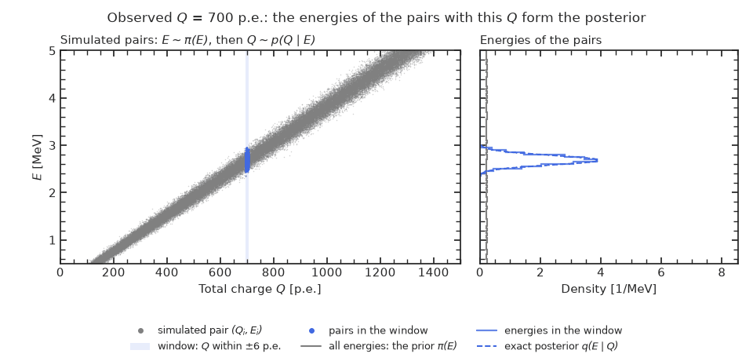</p>

**A posterior from pairs.** Pairs $(Q, E)$ of events at the center appear one by one. The energies of the events in a
narrow window of $Q$ form a histogram, which approaches the posterior $q(E \mid Q)$ for many events and a narrow
window. The window then slides along $Q$.

## The loss in three lines

```math
\begin{aligned}
\mathcal{L}(\phi) &= -\sum_{i=1}^{N} \log \hat q(\theta_i \mid x_i), \qquad \theta_i \sim \pi(\theta),\;\; x_i \sim p(x \mid \theta_i), \\
\frac{\mathcal{L}(\phi)}{N} &\to -\int \pi(\theta)\, p(x \mid \theta) \log \hat q(\theta \mid x)\, \mathrm{d}\theta\, \mathrm{d}x
= -\int p(x) \int q(\theta \mid x) \log \hat q(\theta \mid x)\, \mathrm{d}\theta\, \mathrm{d}x, \\
&= \mathbb{E}_{p(x)}\Big[ H\big(q(\cdot \mid x)\big) + D_\mathrm{KL}\big(q(\cdot \mid x) \,\Vert\, \hat q(\cdot \mid x)\big) \Big] .
\end{aligned}
```

The second line uses Bayes' theorem, $\pi(\theta)\, p(x \mid \theta) = p(x)\, q(\theta \mid x)$, with the evidence
$p(x) = \int \pi(\theta)\, p(x \mid \theta)\, \mathrm{d}\theta$. The entropy $H$ of the posterior does not depend on
$\phi$: the loss is the forward KL divergence of [2a](flows.md#training-maximum-likelihood-is-the-forward-kl-divergence),
averaged over the observations that the simulator makes. It needs pairs, never the posterior or the likelihood. The
code takes the mean over a minibatch. In the package, $\theta$ is in m and MeV and $\hat q$ a density per
$\mathrm{m}^2\,\mathrm{MeV}$, so the loss can be negative.

## The conditional flow

A flow of one parameter $\theta$, conditioned on $x$: the spline of 2a, whose parameters are the output of a network
of $x$,

```math
z = f_\phi(\theta \mid x), \qquad
\hat q(\theta \mid x) = p_Z\big(f_\phi(\theta \mid x)\big) \left\lvert \frac{\partial f_\phi(\theta \mid x)}{\partial \theta} \right\rvert .
```

$f_\phi(\cdot \mid x)$ is a rational-quadratic spline with $K$ bins
([flows.md](flows.md#rational-quadratic-spline-durkan-et-al-2019)), and its $3K - 1$ parameters (bin widths, bin
heights, derivatives) are computed by the network from $x$. For a fixed $x$ it is a flow of 2a; when $x$ changes, the
spline changes with it.

```python
from prob_reco_sbi.npe import ConditionalFlow1D, rq_spline, rq_spline_inverse

z, log_det = rq_spline(theta, params, bound=5.0)  # theta [N], params [N, 3K - 1]: one spline per value
theta = rq_spline_inverse(z, params, bound=5.0)
flow = ConditionalFlow1D(obs_dim=1, bins=16)  # q^(E | ln Q), the reference model of N1
```

<p align="center">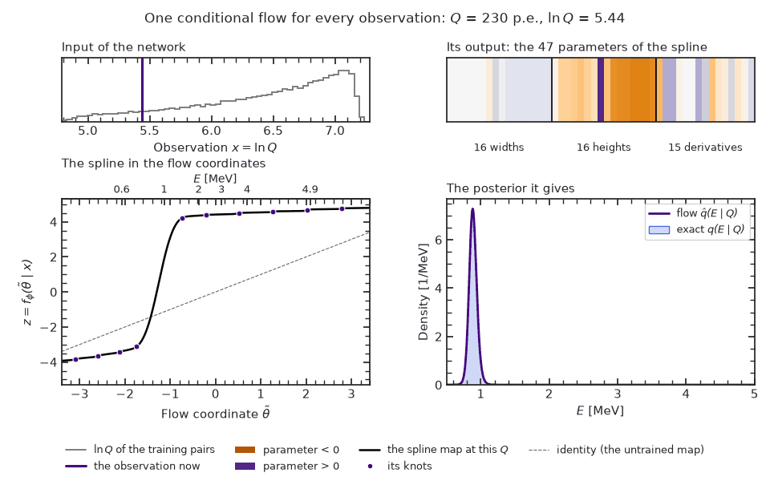</p>

**One network, every observation.** As $Q$ slides through its range, the output of the conditioning network, the
transformation $f_\phi(\cdot \mid Q)$ and the density $\hat q(E \mid Q)$ change with it; the exact posterior is
drawn for comparison. This flow acts on the energy after the logit of [the coordinates](#the-coordinates), so the
energy axis of the spline is not linear.

<p align="center">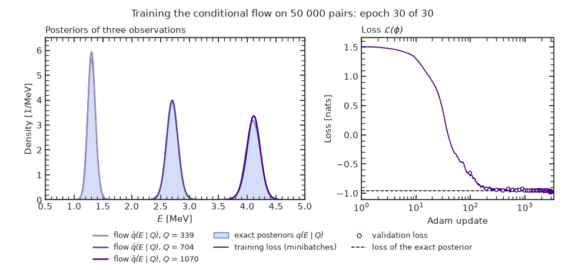</p>

**Training.** $\hat q(E \mid Q)$ for three values of $Q$, epoch by epoch, with the exact posteriors and the loss.

## The chain

Three parameters by the product rule: every factor is a conditional spline as above, conditioned on the observations
and on the parameters before it,

```math
\hat q(\theta \mid x) = \left[\prod_{i=1}^{3} p_Z\big(f_\phi^{(i)}(\tilde\theta_i \mid \psi_i)\big)
\left\lvert \frac{\partial f_\phi^{(i)}(\tilde\theta_i \mid \psi_i)}{\partial \tilde\theta_i} \right\rvert \right]
\left\lvert \det \frac{\partial \tilde\theta}{\partial \theta} \right\rvert, \qquad
\psi_i = \big(h(x), \tilde\theta_1, \dots, \tilde\theta_{i-1}\big).
```

This is the change of variables of 2a once per factor, with the conditioning made explicit; $\tilde\theta$ are the
coordinates of the next section.

- **Input embedding block** $h$: a network of the standardized observations, $x \to 128 \to 128 \to 32$ (ReLU),
  trained together with the rest.
- **Factor** $i$: a rational-quadratic spline $f_\phi^{(i)}$ with $K = 8$ bins on $[-5, 5]$, the identity outside, on
  the standard normal base. Its $3K - 1$ parameters come from its **parameters head**, a network of $\psi_i$ with two
  hidden layers of 64. The last layer of every head starts at zero, so every factor starts as the identity.
- **Normalizing direction** (the density): one pass. **Generative direction** (samples): three passes, coordinate
  by coordinate, each factor inverted exactly with the coordinates before it already known. This is the
  inverse-transform sampling of 2a (F1.3), three times.

```python
from prob_reco_sbi.npe import AutoregressiveFlow

flow = AutoregressiveFlow(obs_dim=64)  # x0, then y0, then E; 8 bins per factor
log_q = flow.log_prob(theta, x)  # theta [N, 3] in m and MeV, x [N, 64] -> [N]
samples = flow.sample(x_o, 500)  # [500, 3]
```

<p align="center">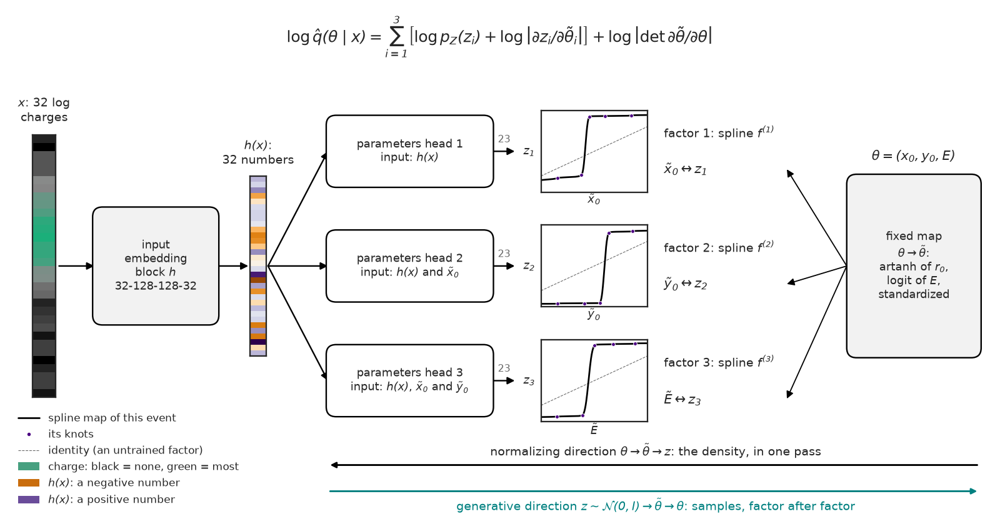</p>

**The chain.** The observations pass the input embedding block once; each factor gets $h(x)$ and the coordinates
before it, and its parameters head returns the parameters of its spline.

<p align="center">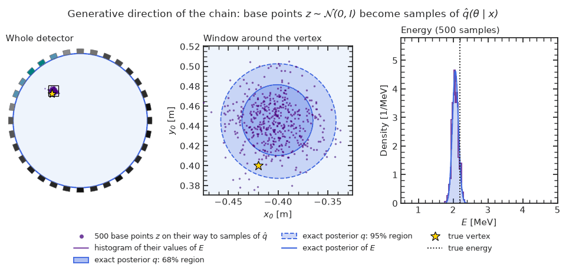</p>

**The generative direction.** 500 points of the base become $x_0$, then $y_0$, then $E$: step by step the cloud moves
onto the posterior, on the disc and on the energy axis.

<p align="center">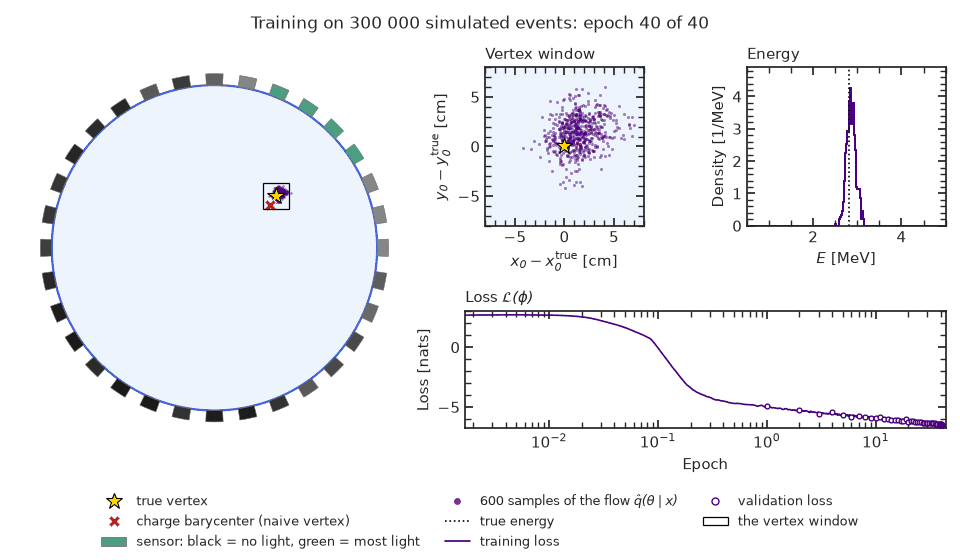</p>

**Training.** The posterior samples of one event on the event display, with its energy and the loss, as the network
learns: from the spread of the prior to the vertex.

## The coordinates

The prior has edges: the wall $r_0 = R$ and the energy limits $E_\mathrm{min}$, $E_\mathrm{max}$. Before the flow,
the package maps the parameters to coordinates $u$ without edges,

```math
(x_0, y_0) \mapsto \frac{\mathrm{artanh}(r_0 / R)}{r_0}\,(x_0, y_0), \qquad
E \mapsto \mathrm{logit}\,\frac{E - E_\mathrm{min}}{E_\mathrm{max} - E_\mathrm{min}}, \qquad
\mathrm{logit}\, p = \log \frac{p}{1 - p},
```

with the log-Jacobians, for $\rho = r_0 / R$ and $p = (E - E_\mathrm{min}) / (E_\mathrm{max} - E_\mathrm{min})$,

```math
\log \left\lvert \det \frac{\partial u}{\partial (x_0, y_0)} \right\rvert
= -2 \log R - \log(1 - \rho^2) + \log \frac{\mathrm{artanh}\, \rho}{\rho}, \qquad
\log \left\lvert \frac{\mathrm{d}u}{\mathrm{d}E} \right\rvert = -\log(E_\mathrm{max} - E_\mathrm{min}) - \log p - \log(1 - p),
```

and standardizes the result with the means and standard deviations of the training pairs: $\tilde\theta$. The
Jacobian of this fixed map enters $\hat q$: it is the last factor in the formula of the chain. The inverse map sends
every point of the plane back inside the disc and every real number back inside the energy range.

```python
from prob_reco_sbi.npe import AutoregressiveFlow, energy_to_unbounded, from_unbounded, to_unbounded

u, log_det = to_unbounded(theta)  # theta [..., 3] -> u [..., 3] and log|det du/dtheta| [...]
theta = from_unbounded(u)
u, log_det = energy_to_unbounded(energy)  # the energy alone (N1)
flow = AutoregressiveFlow(obs_dim=64, unbounded=False)  # without the map: the flow acts on standardized theta
```

<p align="center">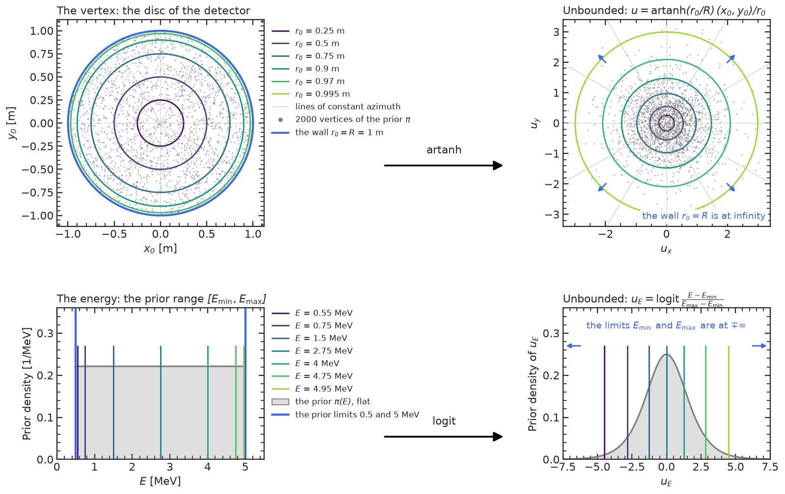</p>

**The map.** The disc and the energy range before and after the map to unbounded coordinates, with circles of
constant radius, values of the energy and samples of the prior: the wall and the energy limits move to infinity.

## The exact references

Where the toy has a likelihood formula, the posterior is known exactly, and every learned posterior can be measured
against it.

### One parameter: the energy at a known vertex

At a fixed vertex every photon is detected with the probability $\kappa$, so the total charge is
$Q \sim \mathrm{Poisson}(Y \kappa E)$. Step by step:

1. Bayes' theorem with the flat prior:
   $q(E \mid Q) \propto \mathcal{L}(Q \mid E) \propto (Y \kappa E)^{Q}\, e^{-Y \kappa E}$ for
   $E_\mathrm{min} \le E \le E_\mathrm{max}$, and 0 outside.
2. As a function of $E$, $E^{Q} e^{-Y \kappa E}$ is the density of a Gamma distribution with the shape $Q + 1$ and
   the rate $Y \kappa$, up to a constant.
3. Normalized in the prior range:

```math
q(E \mid Q) = \frac{(Y \kappa)^{Q + 1} E^{Q}\, e^{-Y \kappa E}}
{\Gamma(Q + 1)\, \big[P(Q + 1, Y \kappa E_\mathrm{max}) - P(Q + 1, Y \kappa E_\mathrm{min})\big]}, \qquad
E_\mathrm{min} \le E \le E_\mathrm{max},
```

with the regularized lower incomplete Gamma function $P(a, t) = \gamma(a, t) / \Gamma(a)$ (`torch.special.gammainc`,
`scipy.special.gammainc`). The KL divergence of a learned posterior to it is an integral over $E$, by quadrature as in
2a:

```math
D_\mathrm{KL}\big(q(\cdot \mid Q) \,\Vert\, \hat q(\cdot \mid Q)\big)
= \int_{E_\mathrm{min}}^{E_\mathrm{max}} q(E \mid Q) \left[\log q(E \mid Q) - \log \hat q(E \mid Q)\right] \mathrm{d}E .
```

```python
from prob_reco_sbi.npe import energy_posterior

post = energy_posterior(Q, kappa)  # flat prior in [0.5, 5] MeV, Y = 1000 photons/MeV
post.pdf(energy), post.log_pdf(energy), post.cdf(energy), post.mean, post.std
```

### Three parameters: the vertex and the energy with straight light

Without scattering and reflection (the presets `straight` and `absorb`) every photon flies straight. From the vertex
it hits sensor $j$ for the directions $\alpha$ in an interval $A_j$, and it survives the path $s(\alpha)$ to the wall
with the probability $e^{-s(\alpha) / \lambda_a}$:

```math
\kappa_j(x_0, y_0) = \frac{1}{2\pi} \int_{A_j} e^{-s(\alpha) / \lambda_a}\, \mathrm{d}\alpha .
```

At the center $\kappa_j = a\, e^{-R / \lambda_a} / (2\pi R)$ for a sensor of width $a$. With
$N \sim \mathrm{Poisson}(Y E)$ photons, each detected independently, the charges are independent,
$n_j \sim \mathrm{Poisson}(\mu_j)$ with $\mu_j = Y E\, \kappa_j$, and the likelihood splits into the pattern and the
total charge $Q = \sum_j n_j$:

```math
\prod_{j} \frac{\mu_j^{n_j}\, e^{-\mu_j}}{n_j!}
= \underbrace{\frac{Q!}{\prod_j n_j!} \prod_j \left(\frac{\kappa_j}{\kappa}\right)^{n_j}}_{\text{pattern}}
\;\times\; \underbrace{\frac{(Y \kappa E)^{Q}\, e^{-Y \kappa E}}{Q!}}_{\text{total charge}} .
```

Only the second factor depends on $E$. With the flat priors, the integral over $E$ is closed:

```math
q(x_0, y_0 \mid x) \propto \prod_j \left(\frac{\kappa_j}{\kappa}\right)^{n_j}
\frac{P(Q + 1, Y \kappa E_\mathrm{max}) - P(Q + 1, Y \kappa E_\mathrm{min})}{Y \kappa\, (E_\mathrm{max} - E_\mathrm{min})}
\qquad \text{inside the disc},
```

with $\kappa_j$ and $\kappa$ taken at $(x_0, y_0)$. At a fixed vertex the energy posterior is the one of the previous
section, with $\kappa(x_0, y_0)$. With scattering or reflection the path of a photon has no closed form, and neither
has the likelihood: the full detector has no exact reference.

```python
from prob_reco_sbi.npe import credible_levels, detection_probability, energy_evidence, grid_posterior

kappa_j = detection_probability(x0, y0, "absorb")  # [..., 32]
log_evidence = energy_evidence(Q, kappa_j.sum(-1))  # log of the integral over E (flat prior in [0.5, 5] MeV)
exact = grid_posterior(charge, "absorb")  # one event: density on a grid, energy marginal, means, covariance
levels = credible_levels(exact.density, [0.68, 0.95])  # density levels of the 68 % and 95 % regions
```

`grid_posterior` finds the posterior with a coarse pass over the disc and then puts a fine grid on it, turned to the
radial and tangential directions of the vertex; it takes about a second per event.

<p align="center">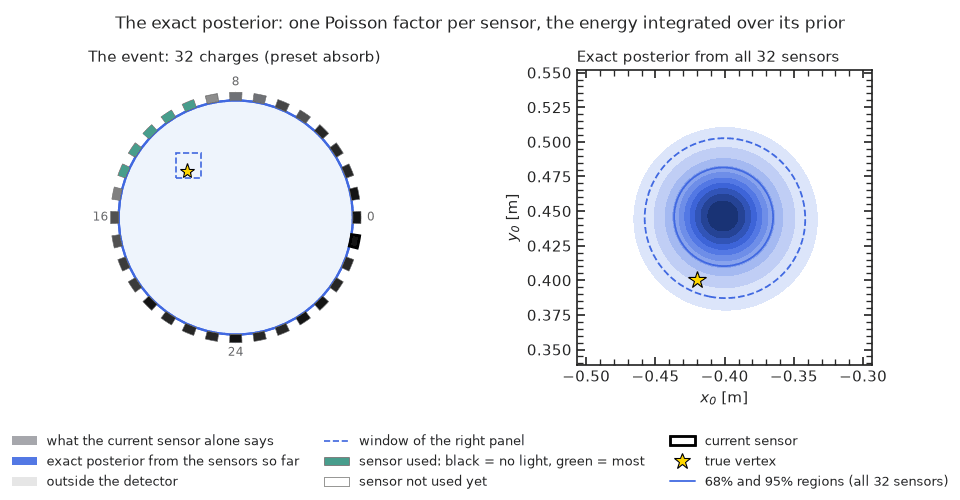</p>

**The likelihood, sensor by sensor.** Every charge adds one factor on the $(x_0, y_0)$ grid, until the posterior is
left.

<p align="center">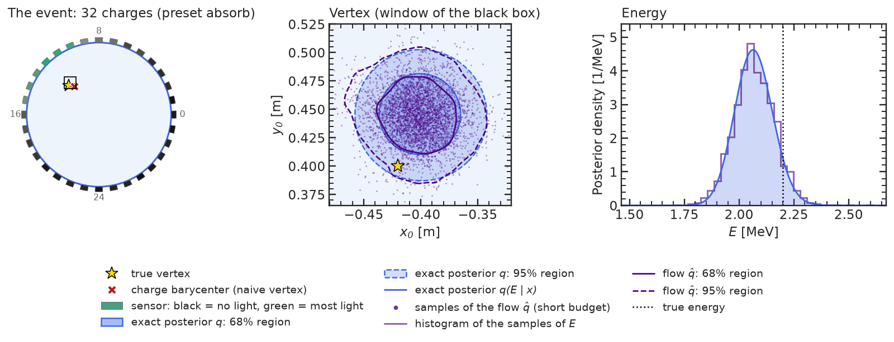</p>

**Exact against learned.** The exact posterior of one event of the preset `absorb` against the samples of the chain,
in $(x_0, y_0)$ and in $E$.

## Reading a posterior without an exact reference

In the full detector the posterior is read from its samples: on the event display, as contours of the 68 % and 95 %
regions, and in the plane of $r_0$ and $E$. Whether these posteriors are reliable is the question of the next stage.

<p align="center">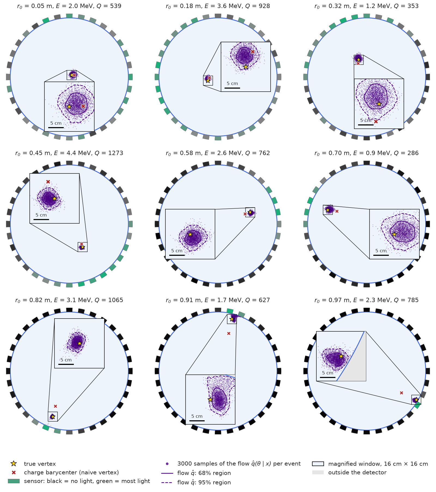</p>

**A gallery.** Posteriors on the event display for nine events from the center to the wall, with the true vertex, the
charge barycenter and the 68 % and 95 % regions in a magnified window.

<p align="center">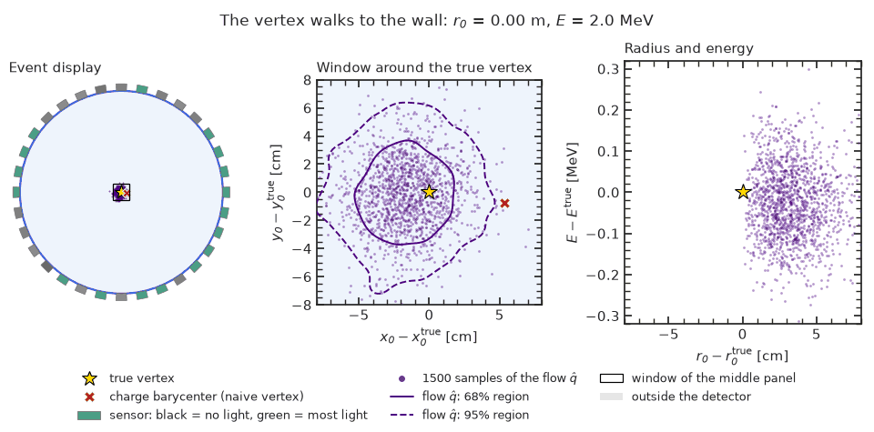</p>

**A walk to the wall.** A vertex walks from the center to the wall, and the display, the posterior and the
$(r_0, E)$ panel follow it.

<p align="center">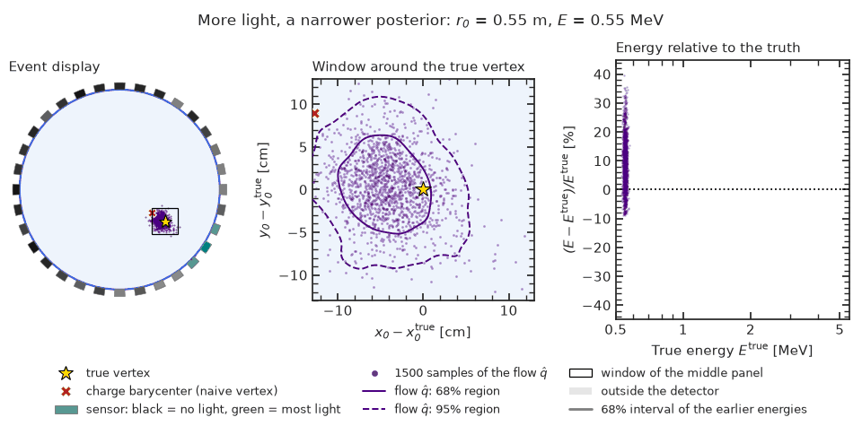</p>

**More light.** The same vertex with the energy rising from 0.55 to 4.8 MeV.

## Two modes

With a ganged readout, sensor $j$ and its mirror image $32 - j$ share one channel: sensor $j$ sits at the angle
$2\pi j / 32$, its mirror image under $y_0 \to -y_0$ at $-2\pi j / 32$. Sensors 0 and 16 lie on the mirror axis and
keep a channel of their own, so there are 17 channels. The charge of a channel is the sum of the charges of its
sensors, its mean time their charge-weighted mean. A response and its mirror image give exactly the same ganged
observations.

```python
from prob_reco_sbi.flash import ganged_channels, ganged_input
from prob_reco_sbi.npe import GaussianChain, load_pairs

ganged_channels(32)  # the channel of every sensor, 0 to 16
x = ganged_input(charge, time_mean)  # [N, 34]: 17 log charges and 17 relative times
theta, x = load_pairs("data/n3_full_train.h5", "ganged")  # the same from a file
gauss = GaussianChain(obs_dim=34)  # the Gaussian comparison model
```

The Gaussian comparison model `GaussianChain` returns a multivariate normal in $\tilde\theta$ with a mean and a full
covariance computed from $x$: what a regression network with a predicted uncertainty gives.

<p align="center">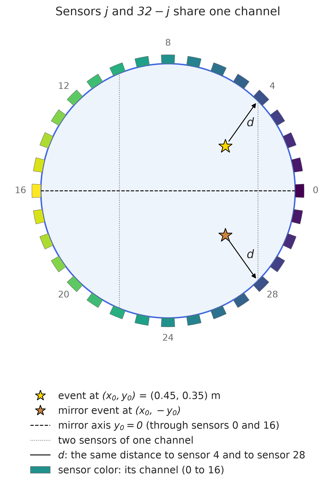</p>

**The ganged readout.** The sensors colored by their channel, the mirror axis, and two mirror events: each is as far
from sensor 4 as the other is from sensor 28, and these two sensors share a channel.

<p align="center">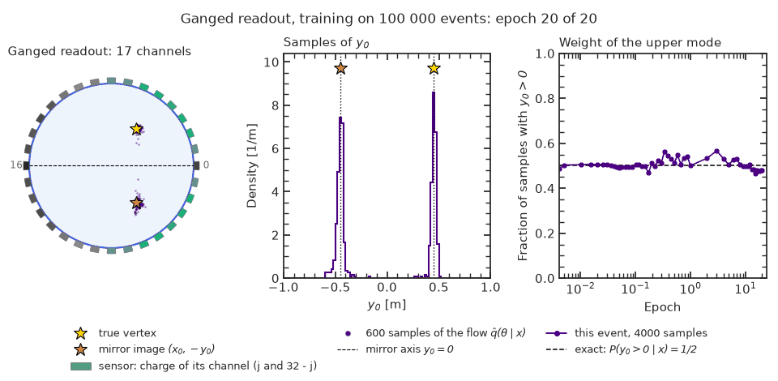</p>

**Two modes appear.** The posterior of one event with the ganged readout during training: one cloud splits into two.
The right panel follows the fraction of the samples with $y_0 > 0$.

<p align="center">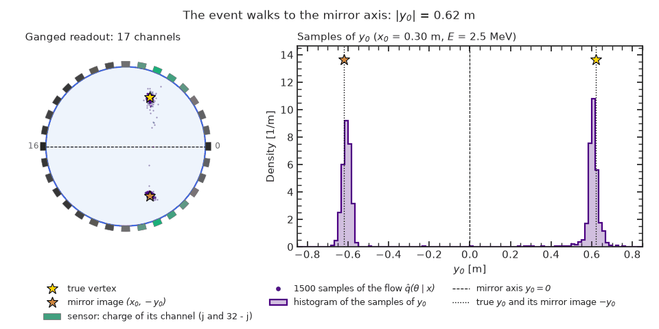</p>

**Toward the mirror axis.** An event walks to the mirror axis, with its posterior samples on the display and the
histogram of their $y_0$.

## The library

The chain is written from scratch, so that every part of it is visible. Libraries offer the same construction. The
course uses zuko (Rozet et al.): its neural spline flow `NSF` (Durkan et al. 2019) is a masked autoregressive flow
(Papamakarios et al. 2017). In each of its $N_\mathrm{flows}$ flows, one masked conditioning network returns the
spline parameters of all coordinates at once; the mask lets the parameters of coordinate $i$ depend only on the
coordinates before it and on the observations, which is the product rule of the chain. The order of the coordinates
alternates from flow to flow. zuko calls the observations the context.

```python
import zuko

flow = zuko.flows.NSF(features=3, context=64, transforms=3, hidden_features=[128, 128])  # N_flows = 3
log_q = flow(x).log_prob(theta)  # x [N, 64], theta [N, 3] -> [N]
samples = flow(x_o).sample((500,))  # [500, 3]
```

zuko is installed with the `analysis` extra. The [sbi toolbox](https://github.com/sbi-dev/sbi) of the guide wraps
NPE, the training loop included, in a few calls; the course writes the loop itself.

<p align="center">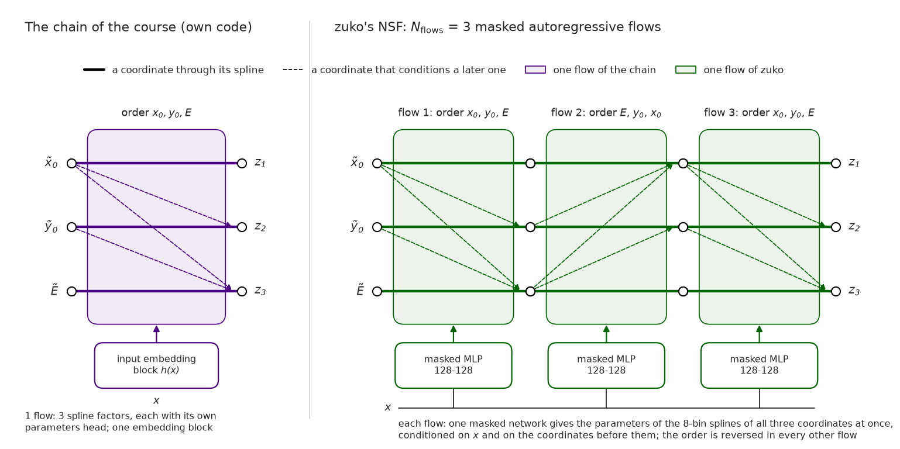</p>

**A masked autoregressive flow.** zuko's flow, with one masked conditioning network per flow and three flows in
alternating order, next to the chain.

## Package overview

| module | contents |
|---|---|
| `spline` | `rq_spline`, `rq_spline_inverse` (the spline of `flows1d.RQSpline` with one set of knots per value), `rq_knots`, `n_spline_params` |
| `coordinates` | `to_unbounded`, `from_unbounded`, `energy_to_unbounded`, `vertex_to_unbounded` and their inverses, `inside_prior` |
| `flow` | `PosteriorEstimator` (the base class: coordinates, standardization, `log_prob`, `sample`), `ConditionalFlow1D`, `AutoregressiveFlow`, `GaussianChain`, `mlp` |
| `data` | `load_pairs`, `to_pairs` (representations `"charge+time"`, `"charge"`, `"q"`, `"ganged"`), `observations` (the same for arrays of charges and times), `parameter_names` |
| `train` | `fit` (minibatch maximum likelihood with Adam and a validation set), `History`, `save_model`, `load_model`, `mean_loss` |
| `reference` | `detection_probability`, `energy_posterior`, `energy_evidence`, `grid_posterior`, `credible_levels` |

Everything is imported from `prob_reco_sbi.npe`. A complete fit:

```python
import torch
from prob_reco_sbi.npe import AutoregressiveFlow, fit, load_pairs

theta, x = load_pairs("data/n3_full_train.h5", "charge+time")  # make the data with examples/make_npe_data.py
torch.manual_seed(1)  # the initial weights
flow = AutoregressiveFlow(obs_dim=64)
history = fit(flow, theta[:100_000], x[:100_000], epochs=20, validation=(theta[-10_000:], x[-10_000:]), seed=1)
samples = flow.sample(x[-1], 500)  # [500, 3]: x0, y0 [m], E [MeV]
```

`examples/npe_quickstart.py` does the same from the command line, and `examples/make_npe_data.py` makes the data of
the tasks.

## References

- M. Deistler, J. Boelts, P. Steinbach, G. Moss, T. Moreau, M. Gloeckler et al., "Simulation-based inference: a
  practical guide", arXiv:2508.12939 (2025).
- G. Papamakarios and I. Murray, "Fast ε-free inference of simulation models with Bayesian conditional density
  estimation", NIPS 2016, arXiv:1605.06376.
- D. S. Greenberg, M. Nonnenmacher and J. H. Macke, "Automatic posterior transformation for likelihood-free
  inference", ICML 2019, arXiv:1905.07488.
- G. Papamakarios, T. Pavlakou and I. Murray, "Masked autoregressive flow for density estimation", NIPS 2017,
  arXiv:1705.07057.
- C. Durkan, A. Bekasov, I. Murray and G. Papamakarios, "Neural spline flows", NeurIPS 2019, arXiv:1906.04032.
- K. Cranmer, J. Brehmer and G. Louppe, "The frontier of simulation-based inference", Proc. Natl. Acad. Sci. USA
  117, 30055 (2020), doi:10.1073/pnas.1912789117.
- A. Gavrikov, A. Serafini, D. Dolzhikov, A. Garfagnini, M. Gonchar, M. Grassi et al. (JUNO-Italia Consortium),
  "Simulation-based inference for precision neutrino physics through neural Monte Carlo tuning", Commun. Phys. 9,
  63 (2026), doi:10.1038/s42005-026-02499-6.
- F. Rozet et al., "Zuko: normalizing flows in PyTorch" (2022), doi:10.5281/zenodo.7625672.
