# Reference answers: A Flash in the Dark

Assembled from `answers/T*.md` in question-ID order by `make_answers.py`. The figures are in `figures/` (PDF and PNG, linked below), every number comes from `results/*.json`, and `README.md` says which script makes what.

## Contents

- [T0.1 Set-up](#t0-1-set-up)
- [T0.2 How long does it take?](#t0-2-how-long-does-it-take)
- [T0.3 Inspect the file](#t0-3-inspect-the-file)
- [T1.1 What did we simulate?](#t1-1-what-did-we-simulate)
- [T1.2 The prior that NPE will use](#t1-2-the-prior-that-npe-will-use)
- [T2.1 Sensor charges, hit sensors, empty sensors](#t2-1-sensor-charges-hit-sensors-empty-sensors)
- [T2.2 Total charge and light collection](#t2-2-total-charge-and-light-collection)
- [T2.3 Mean, first and relative times](#t2-3-mean-first-and-relative-times)
- [T2.4 The network input](#t2-4-the-network-input)
- [T2.5 Own proposals](#t2-5-own-proposals)
- [T3.1 The physics ladder, configuration by configuration](#t3-1-the-physics-ladder-configuration-by-configuration)
- [T3.2 Expected charge of a sensor: straight light and absorption](#t3-2-expected-charge-of-a-sensor-straight-light-and-absorption)
- [T3.3 Which process does what?](#t3-3-which-process-does-what)
- [T3.4 How hard is the inverse problem?](#t3-4-how-hard-is-the-inverse-problem)
- [T4.1 Event display](#t4-1-event-display)
- [T4.2 Event display with timing](#t4-2-event-display-with-timing)
- [T4.3 Photon paths of one event](#t4-3-photon-paths-of-one-event)
- [T4.4 One theta, four presets](#t4-4-one-theta-four-presets)
- [T4.5 Animation (bonus)](#t4-5-animation-bonus)
- [T5.1 The same theta many times (bonus)](#t5-1-the-same-theta-many-times-bonus)
- [T5.2 Degeneracy: the same mean Q from different (E, r) (bonus)](#t5-2-degeneracy-the-same-mean-q-from-different-e-r-bonus)
- [T5.3 Detector design (bonus)](#t5-3-detector-design-bonus)
- [T5.4 Detector effects: which features suffer most? (bonus)](#t5-4-detector-effects-which-features-suffer-most-bonus)

## T0.1 Set-up

The fast test suite ends with `165 passed, 10 deselected`; our run took 22 s (24 s wall) on the CPU with 16 torch
threads, Python 3.11.5, torch 2.14.1+cpu, numpy 2.4.6 and h5py 3.16.0.

```bash
git clone https://github.com/ArseniiGav/prob-reco-sbi.git && cd prob-reco-sbi
python3 -m venv .venv && source .venv/bin/activate
python -m pip install --upgrade pip
python -m pip install -e ".[analysis,dev]"
python -m pytest
```

**Details**

- The 10 deselected tests are the slow ones (statistical regression and fresh-process reproducibility), run with
  `python -m pytest -m slow`; without the course reference data 8 of them are skipped.
- The number of passed tests grows when tests are added; `results/T0.json` holds the summary of the last run.
- `pytest` is not in the `analysis` extra (we checked its dependency closure), which is why the commands install
  `.[analysis,dev]`. The `analysis` extra installs JupyterLab, so `python -m jupyter lab` opens the notebooks in the
  right environment.

*Numbers:* `results/T0.json` (`task0_setup.py`). No figure.

## T0.2 How long does it take?

The time is proportional to N (log-log slopes 0.994-1.005, fixed overhead below 0.02 s): on the CPU with 16 torch
threads the full model runs at 5,491 events/s (10 000 events in 1.85 s) and straight light at 9,639 events/s. The
preset matters through the number of transport steps per photon, 1.00 (straight, absorb) to 1.55 (full). A GPU
(NVIDIA A30) is 4.2 times faster than 16 CPU threads for 50 000 events.

**Details**

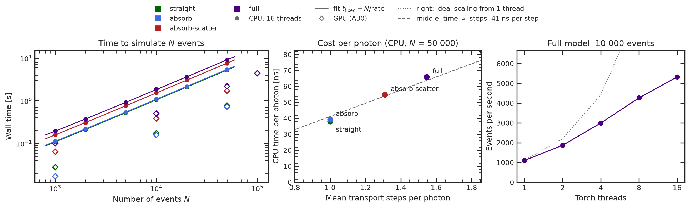
- *End to end:* `flashsim generate -n 10000 --seed 1` took 3.30 s, of which 1.89 s simulation and 1.3 s to start
  Python and import torch.
- *Cost per photon:* 38.4, 39.6, 55.4 and 66.2 ns for straight, absorb, absorb-scatter and full, about 41 ns per
  photon-step (steps per photon 1.00, 1.00, 1.31, 1.55, counted on fully recorded paths). The full model is 1.73 times
  slower per photon than straight light, and every sample costs in proportion to its photons, Y E per event (2746 on
  average for the default prior).
- *Threads:* the full model runs at 1,100, 3,012 and 5,356 events/s with 1, 4 and 16 threads (speed-up 2.7 and
  4.9), so a laptop with a few cores is enough.
- *GPU:* 23,105 events/s for 50 000 events (measured once in a CUDA environment, `T0.2_gpu`); 1000-event runs are
  dominated by overhead (9,998 events/s).
- *Caveat:* the machine was shared (load average 9.9 rising to 14.4), and five runs of the same script gave
  4,122-5,491 events/s for the full model (`T0.2_history_rate_range`): the rates are indicative to about 25 %, the
  linear scaling and the ordering of the presets are robust.

*Figure:* [`t0_2_timing`](figures/t0_2_timing.png). *Numbers:* `results/T0.json` under `T0.2`, `T0.2_history`, `T0.2_gpu`, `T0.2_threads`,
`T0.2_derived` (`task0_timing.py`; last run of `run_all.sh` on 2026-10-21 13:49 UTC, 16 torch threads).

## T0.3 Inspect the file

`flashsim info FILE`, `python solutions/stage1_flash/task0_inspect.py` and `load(FILE)` all show the same content: four groups of
datasets and two JSON attributes, the complete configuration and the provenance. The 10 000 events of T0.2 take
2.64 MB.

| group | datasets (type) | shape |
|---|---|---|
| `/truth` | `event_id` (int64); `x`, `y` [m], `energy` [MeV], `t0` [ns] (float32) | (10000,) |
| `/response` | `charge` (int32); `time_mean`, `time_first` [ns] (float32, NaN where `charge == 0`) | (10000, 32) |
| `/photons` | `n_emitted`, `n_detected`, `n_absorbed_bulk`, `n_absorbed_wall`, `n_absorbed_sensor`, `n_lost`, `n_detected_direct`, `n_detected_scattered`, `n_detected_reflected`, `n_noise` (int32) | (10000,) |
| `/detector` | `sensor_x`, `sensor_y` [m], `sensor_phi` [rad] (float64) | (32,) |

**Details**

- *Root attributes:* `format_version` = 1, `n_events`, `config` (geometry, optics, readout, prior; here exactly the
  `full` preset: `load(path).config == preset("full")` is True) and `provenance` (seed, device, chunking, package and
  library versions, creation time, wall time and, for files written by `flashsim`, the preset, the overrides and the
  command).
- *Optional groups:* with `--save-hits --save-tracks 3` the file also gets `/hits` (one row per hit, 896.5 hits per
  event, 7 columns) and `/tracks` (300 recorded photons with 770 points for 3 events), and grows to 7.15 MB for
  1000 events.
- `git_commit` is `None` in these files because the working tree had no commit yet.

*Numbers:* `results/T0.json` under `T0.3`. No figure.

## T1.1 What did we simulate?

E and t0 are flat in [0.5, 5] MeV and [0, 10] ns, and the vertex is uniform in the *area* of the disc. That is why r
is not flat: the ring between r and r + dr has area 2πr dr, so p(r) = 2r/R² and r² is uniform (the generator samples
r = R √u). The marginals of x0 and y0 are semicircles, p(x0) = 2 √(R² − x0²) / (π R²).

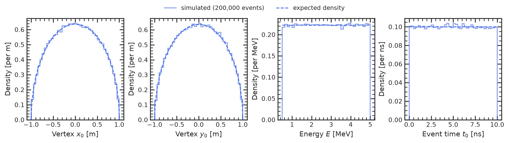
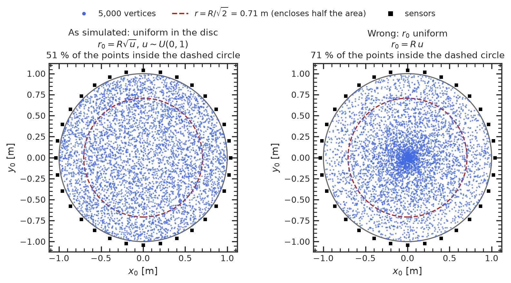
**Details**

- The histograms follow these densities: KS p-values 0.10-0.88 for x0, y0, E, t0, the azimuth and r².
- Mean r = 0.667 m (expected 2/3), median r = 0.706 m (expected 1/√2 = 0.707); only 25.0 % of the events lie inside
  r < 0.5 m and 19.0 % lie within 10 cm of the wall (r > 0.9 m).

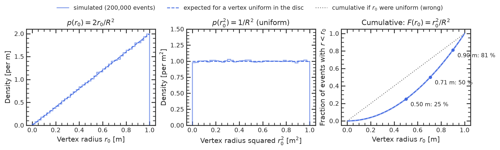
- The classic mistake r = R u (right panel of [`t1_1_vertices`](figures/t1_1_vertices.png)) piles the vertices up at the centre: it would put 50 %
  of the events inside r < 0.5 m, and the KS test rejects "r uniform" for our sample with D = 0.25.

*Figures:* [`t1_1_prior_marginals`](figures/t1_1_prior_marginals.png), [`t1_1_vertices`](figures/t1_1_vertices.png), [`t1_1_radius`](figures/t1_1_radius.png) (200 000 events of the default prior,
`task1_prior.py`). *Numbers:* `results/T1.json`.

## T1.2 The prior that NPE will use

The prior is π(x0, y0, E) = 1/(π R²) × 1/(4.5 MeV) = 0.0707 per m² per MeV inside the disc r ≤ 1 m and
0.5 ≤ E ≤ 5 MeV, zero outside; t0 ~ U(0, 10) ns is a nuisance parameter that the relative times remove (T2.3). NPE
learns p(θ | x) ∝ p(x | θ) π(θ) from pairs (θ, x) drawn from this prior, so the prior fixes where the posterior can put
probability, how much weight each region gets, and the population over which the coverage of the posterior holds.

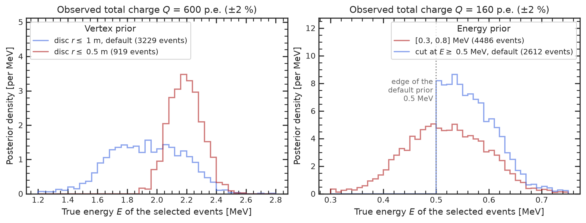
**Details** (the figure makes this concrete without any network: keeping the simulated events whose total charge Q
falls in a narrow window gives the posterior of E given Q alone, rejection ABC)

- *The prior shapes the answer:* for Q = 600 ± 2 % p.e. the energy is 1.93 MeV (16-84 %: 1.67-2.20) with the disc
  prior, but 2.19 MeV (2.08-2.31) if the vertex prior is restricted to r ≤ 0.5 m. The same observation gives a
  different answer, because central events collect less light and need more energy.
- *Edges:* for Q = 160 ± 2 % p.e. an energy prior extended to [0.3, 0.8] MeV puts (41.8 ± 0.7) % of the posterior
  below 0.5 MeV (4486 events in the window, binomial error); the default prior cuts that part away and the posterior
  piles up against the edge (median 0.563 ± 0.001 instead of 0.517 ± 0.002 MeV).
- Edge effects are not rare: 9.75 % of the prior lies within 5 cm of the wall and 4.4 % within 0.1 MeV of an energy
  limit.

*Figure:* [`t1_2_prior_matters`](figures/t1_2_prior_matters.png) (`task1_prior.py`). *Numbers:* `results/T1.json`.

## T2.1 Sensor charges, hit sensors, empty sensors

A sensor typically sees 14 p.e. (median; mean 28.0), with a long tail up to 2599 p.e. from vertices near the wall.
Almost every sensor is hit: 88.4 % of the events have all 32 sensors hit. Empty sensors (0.70 % overall) follow the
Poisson law P(n_j = 0) = exp(−μ_j): their fraction falls exponentially with E and rises toward the wall, where the far
side of the ring sees little light.

**Details**

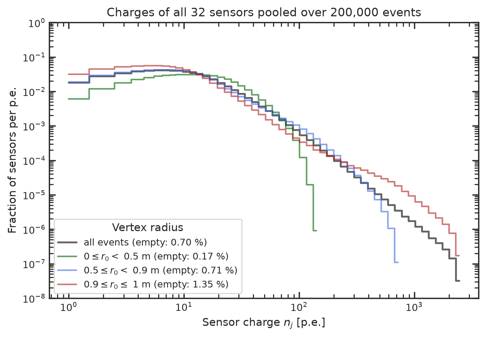
- *Pooled charges:* median 14, mean 28.0, 99th percentile 234 p.e.; the tail above 145 p.e. comes only from r > 0.5 m,
  where one sensor can catch most of the light.

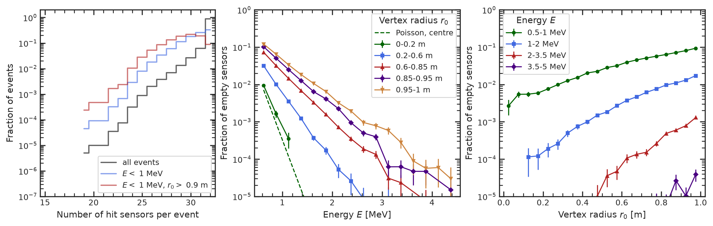
- *Hit multiplicity:* mean 31.78 of 32 sensors, minimum 19; only (8.8 ± 0.4) % of the 4244 events with E < 1 MeV and
  r > 0.9 m have all sensors hit.
- *Empty sensors vs E and r:* 1.45 % for E < 1 MeV and r < 0.5 m, 9.3 % for E < 1 MeV and r > 0.95 m, 0.004 % for
  E > 3.5 MeV and r > 0.95 m.
- *Check:* for r < 0.2 m the fraction is close to the Poisson expectation for a vertex at the centre,
  exp(−Y E f_c / M) with f_c = 0.2615: 0.94 % measured vs 0.71 % expected in the lowest energy bin, the excess coming
  from vertices up to 0.2 m off-centre.

*Figures:* [`t2_1_sensor_charges`](figures/t2_1_sensor_charges.png), [`t2_1_hit_and_empty_sensors`](figures/t2_1_hit_and_empty_sensors.png) (200 000 prior events, `task2_response.py`).
*Numbers:* `results/T2.json` under `T2.1`.

## T2.2 Total charge and light collection

Q grows linearly with E, but at a given E it spreads over a band, because the light collection Q/(YE) depends on the
vertex: 0.261 at the centre, 0.401 in the last radius bin (a factor 1.53), disc average 0.325. The reason is the path
length, not the solid angle: from a vertex near the wall about half of the photons reach the nearby wall after a short
way and are not absorbed or scattered in the bulk (λa = 1.5 m, λs = 2 m).

**Details**

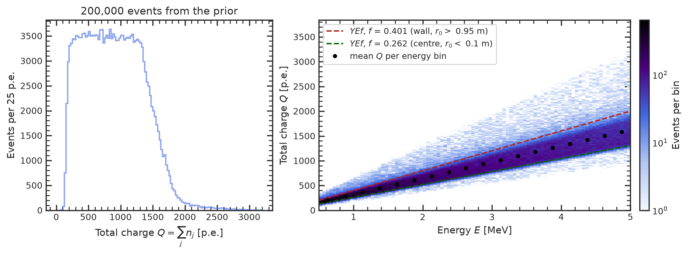
- *Q distribution:* 90 to 3191 p.e. (1-99 %: 165-2018 p.e., median 873); the flat energy prior makes the plateau, the
  position dependence of the collection the soft edges and the high tail.
- *Band at fixed E:* at E = 2.00 ± 0.05 MeV the spread of Q is 112 p.e., while photon statistics alone would give
  25.5 p.e.; at E = 2 MeV with r < 0.1 m the spread is purely Poisson (22.6 vs 22.9 p.e.). At 2 MeV the collection is
  523 p.e. at the centre and 806 p.e. at the wall.

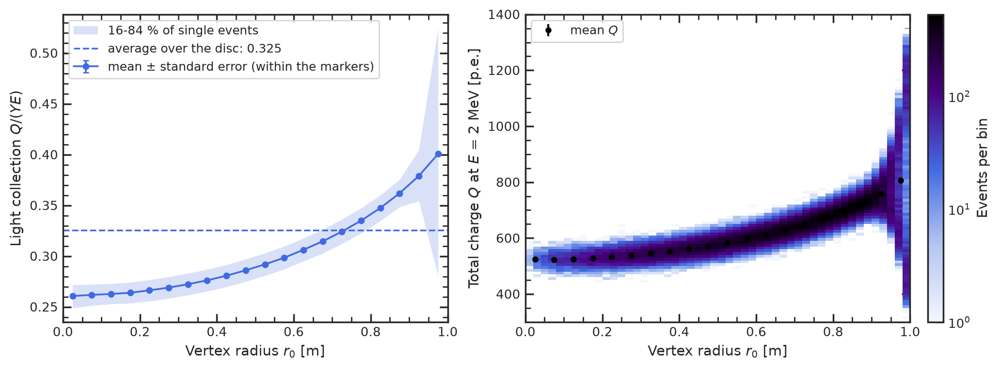
- *Collection vs r:* standard errors below 0.001 (error bars smaller than the markers). The single-event band widens
  sharply in the last bin (16-84 %: 0.28-0.52) because there the collection depends on whether the vertex faces a
  sensor or a gap (T2.5, item 8).
- *Why not the solid angle:* averaged over the azimuth, the angle under which all sensors together are seen is the
  photocoverage at every radius (what the near sensors gain, the far ones lose); without absorption and scattering the
  collection does not rise at all (T3.1: straight light stays at 0.509 from the centre to the wall; T3.3 splits the
  rise into its parts).

*Figures:* [`t2_2_total_charge`](figures/t2_2_total_charge.png), [`t2_2_light_collection`](figures/t2_2_light_collection.png) (200 000 prior events; 100 000 events at E = 2 MeV).
*Numbers:* `results/T2.json` under `T2.2`.

## T2.3 Mean, first and relative times

Every recorded time contains the unknown t0 ~ U(0, 10 ns), which is as large as the whole time-of-flight range
(d_j / c_n = 0-10 ns), so absolute times would mostly measure t0. The relative times τ_j − τ̄, with τ̄ the
charge-weighted mean over the hit sensors, remove t0 exactly and keep the pattern: near sensors early, far sensors
late.

**Details**

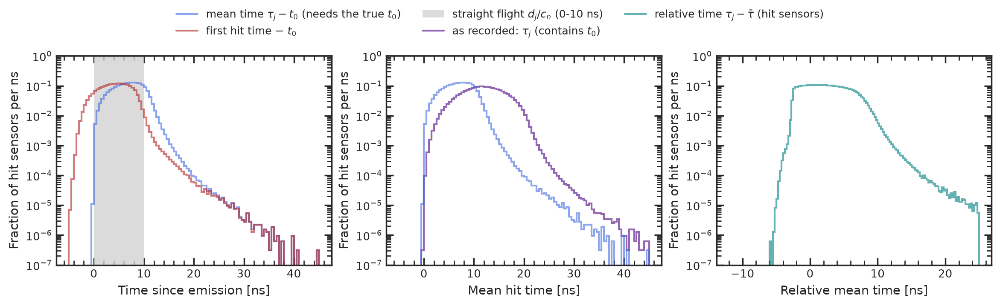
- *Mean times from the emission:* τ_j − t0 has median 7.0 ns (1-99 %: 1.0-12.8 ns) with a tail of scattered and
  reflected light beyond 20 ns (13.3 % are later than 10 ns).
- *First times:* earlier (median 4.3 ns); 8.9 % even precede t0, because the earliest of many photons picks the early
  tail of the 1 ns jitter.
- *Effect of t0:* the spread of the mean times grows from 2.80 ns (τ_j − t0) to 4.01 ns as recorded.

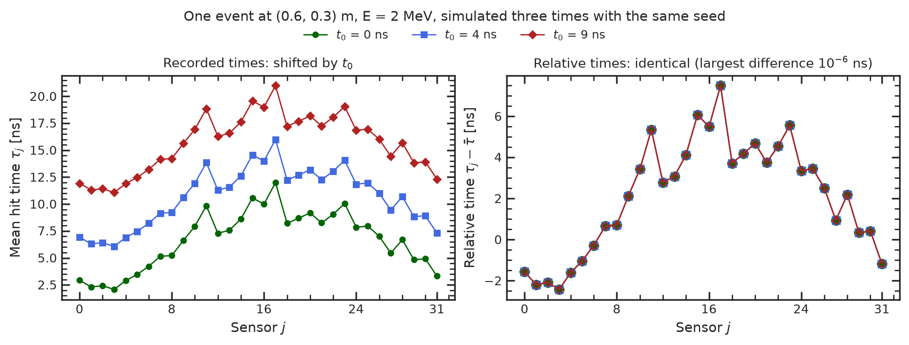
- *Check of the cancellation:* the same event simulated with the same seed at t0 = 0, 4 and 9 ns gives relative times
  that agree to 9.5 × 10⁻⁷ ns (float32 rounding); shifting t0 by 7.5 ns for 2000 events changes the network input by at
  most 3.8 × 10⁻⁶ ns. Only the common offset of each event is lost (dominated by t0 anyway); the pattern (spread
  3.14 ns) stays.

*Figures:* [`t2_3_times`](figures/t2_3_times.png), [`t2_3_relative_times`](figures/t2_3_relative_times.png) (`task2_response.py`). *Numbers:* `results/T2.json` under `T2.3`.

## T2.4 The network input

`network_input(charge, time_mean)` returns a float32 array of shape [N, 64]: the charge half log(1 + n_j) and the time
half τ_j − τ̄ in ns. The two halves have different units and scales, so each of the 64 inputs should be standardised
before training. An empty sensor is the point (0, 0): unambiguous in the charge half, ambiguous in the time half.

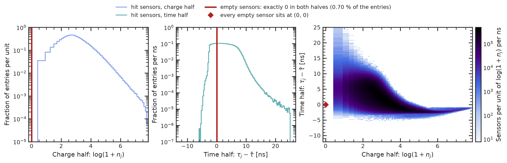
**Details**

- *Scales:* charge half mean 2.78, standard deviation 0.99, maximum 7.86; time half mean 2.53 ns, standard deviation
  3.13 ns, 1-99 %: −2.5 to 9.7 ns.
- *Physics in the joint distribution:* bright (near) sensors are early and dim (far) sensors late (correlation −0.67
  on hit sensors); this is also why the plain mean of the time half is positive (2.53 ns) while its charge-weighted
  mean is zero by construction (largest deviation 1.1 × 10⁻⁷ ns).
- *Empty sensors* (0.70 % of all entries): log(1 + 0) = 0, and the time is set to 0 by convention. A hit sensor has at
  least log 2 = 0.69 in the charge half, but in the time half a 0 looks exactly like a sensor firing at the mean time,
  so the network has to learn from the charge half that the time is missing. No event of this sample has a single hit
  sensor, so every exact zero in the time half belongs to an empty sensor.

*Figure:* [`t2_4_network_input`](figures/t2_4_network_input.png) (200 000 prior events, `task2_response.py`). *Numbers:* `results/T2.json` under
`T2.4`.

## T2.5 Own proposals

Ten proposals, seven from the task sheet and three of our own. The common thread: the total charge alone mixes E and the vertex, the charge pattern and the times carry the rest. Every item is a figure of its own.

**Menu**

1. Charge versus vertex-sensor distance d_j - [`t2_5_charge_vs_distance`](figures/t2_5_charge_vs_distance.png)
2. First-hit time versus d_j and the slope 1/c_n - [`t2_5_first_hit_time`](figures/t2_5_first_hit_time.png)
3. Charge-weighted barycentre versus the true vertex - [`t2_5_barycentre`](figures/t2_5_barycentre.png)
4. Naive energy from Q with one calibration constant - [`t2_5_naive_energy`](figures/t2_5_naive_energy.png)
5. Sensor-sensor charge correlations - [`t2_5_correlations`](figures/t2_5_correlations.png)
6. Photon fates versus r - [`t2_5_photon_fates`](figures/t2_5_photon_fates.png)
7. Direct / scattered / reflected composition versus r - [`t2_5_composition`](figures/t2_5_composition.png)
8. Own: azimuthal modulation near the wall, vertex facing a sensor or a gap - [`t2_5_azimuthal_modulation`](figures/t2_5_azimuthal_modulation.png)
9. Own: the E-r degeneracy of Q at fixed Q, and how the charge pattern breaks it - [`t2_5_energy_radius_degeneracy`](figures/t2_5_energy_radius_degeneracy.png)
10. Own: principal components of the log charges - [`t2_5_pca_network_input`](figures/t2_5_pca_network_input.png)

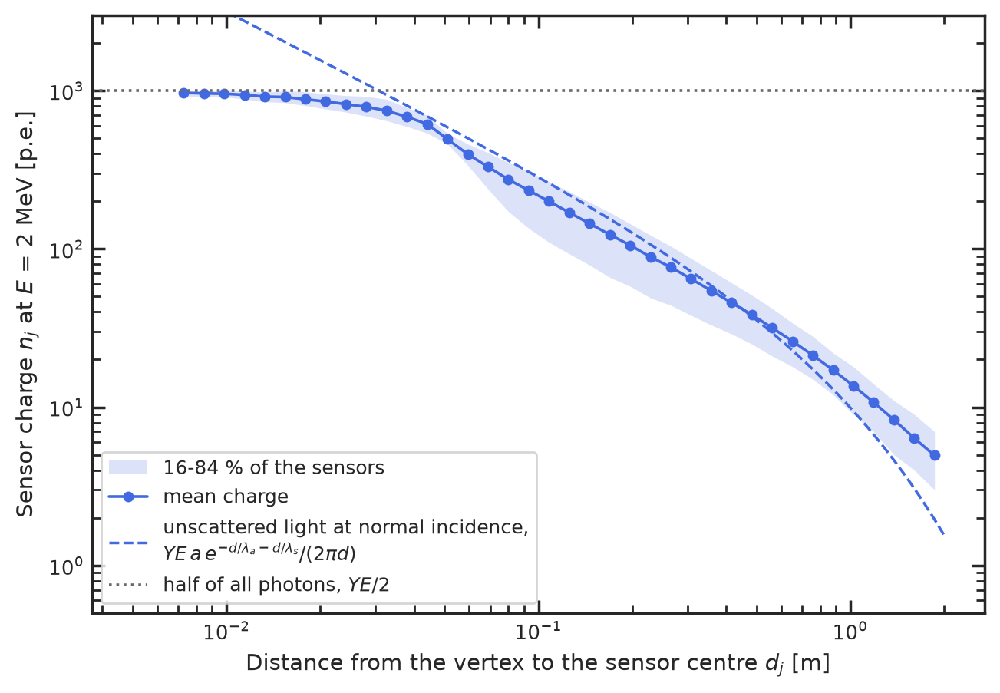
### 1. Charge versus distance

At E = 2 MeV the mean sensor charge falls from 993 p.e. for a vertex touching a sensor
(half of all photons, Y E / 2 = 1000) to 14.2 p.e. at d = 1 m and 5.0 p.e. at 1.9 m. Between about 5 cm and 0.5 m it
runs parallel to the 2-D law ∝ exp(-d/λ)/d (an arc subtends an angle ∝ 1/d in two dimensions, not a solid angle
∝ 1/d²), but below the curve of unscattered light at normal incidence (0.1 m: 218 versus 283 p.e.), because most
sensors are seen at an angle; at large distances it lies above it, where scattered and reflected light dominate
(1.9 m: 5.0 versus 1.8 p.e.). The wide band shows that the distance alone does not fix the charge.

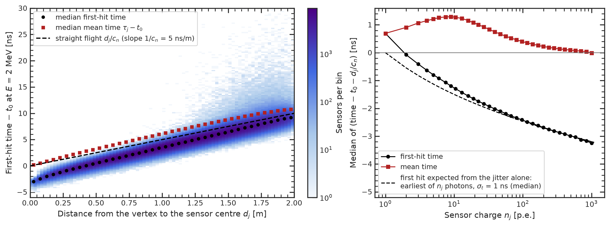
### 2. First-hit time versus distance

The median first-hit time rises with d_j, but a straight-line fit (0.3-1.8 m)
gives 5.98 ns/m and -2.47 ns instead of 1/c_n = 5 ns/m through zero, and 94.0 % of the first hits arrive before
t0 + d_j/c_n. The first hit is the earliest of n_j jittered photons, and its offset follows the expectation for
1 ns jitter alone (median of the minimum of n Gaussians: -1.50, -2.46, -2.83 ns for n = 10, 100, 300; measured -1.30,
-2.41, -2.82 ns); since the near sensors are the bright ones, the offset changes with d and steepens the slope. The
mean time has the opposite bias (+0.2 to +1.3 ns, late light): timing does carry the vertex, but entangled with the
charge.

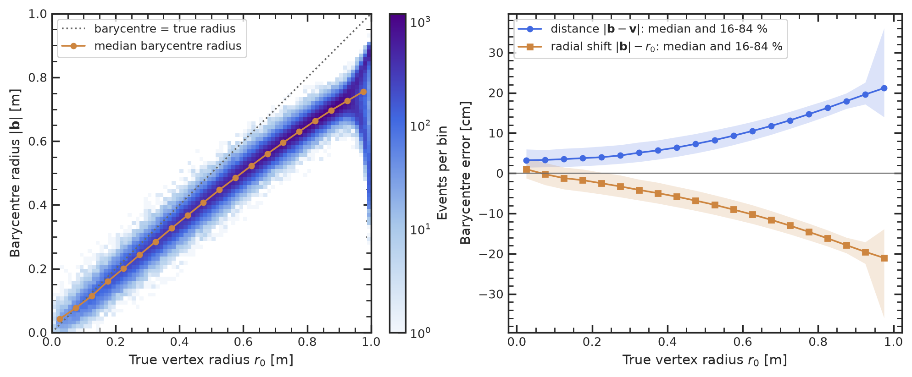
### 3. Barycentre

The charge-weighted mean of the sensor positions has a median error of 3.3 cm at the centre
(r < 0.1 m), 12.7 cm over the disc and 21.2 cm next to the wall (r > 0.95 m), and it is pulled inwards: |b|/r falls
from 0.97 (0.05 < r < 0.1 m) to 0.78 in the last bin, a radial shift of -21 cm, and |b| never exceeds 0.93 m. The
direction is good (median azimuth error 1.3° for r > 0.3 m), but the charge pattern is too smooth for a weighted mean:
even the far side of the ring collects light and pulls the estimate towards the centre.

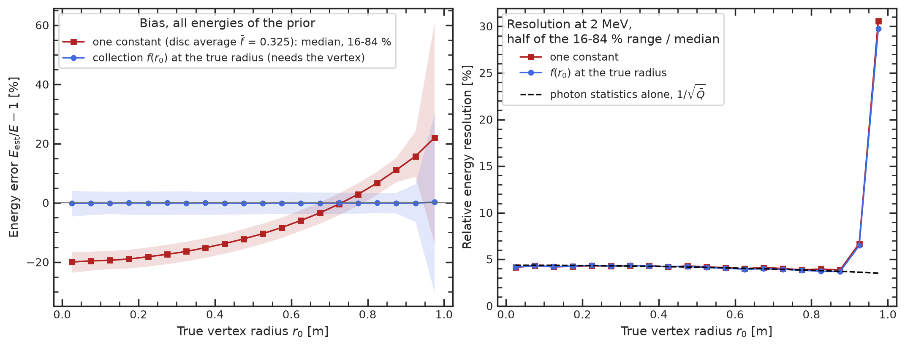
### 4. Naive energy

With one constant, the disc average f̄ = 0.3254, E = Q/(Y f̄) is biased by -20.0 % at the centre
and +22.0 % at the wall, crossing zero at r ≈ 0.73 m; over the whole prior its 16-84 % half-width is 14.1 %, against
4.5 % if the collection f(r) at the true radius is used and a photon-statistics median of 3.4 %. At a fixed 2 MeV the
resolution equals the photon statistics 1/sqrt(Q) (4.1-4.4 % falling to 3.9 %) up to r = 0.9 m, but jumps to 6.7 % and
30.6 % in the last two bins, and knowing r exactly does not cure it (6.5 %, 29.8 %): near the wall the collection
depends on the vertex in two dimensions (item 8). T3.4 repeats this estimator for every preset with the measures of
the TASKS.md hint (k = median of Q/E, median bias, central 68 % interval) and with 1 cm bins in the last 10 cm; its
wall bias for the full model is larger than the +22.0 % quoted here for r > 0.95 m, because the last centimetre alone
is more extreme than the whole last 5 cm (see answers/T3.4.md for the numbers).

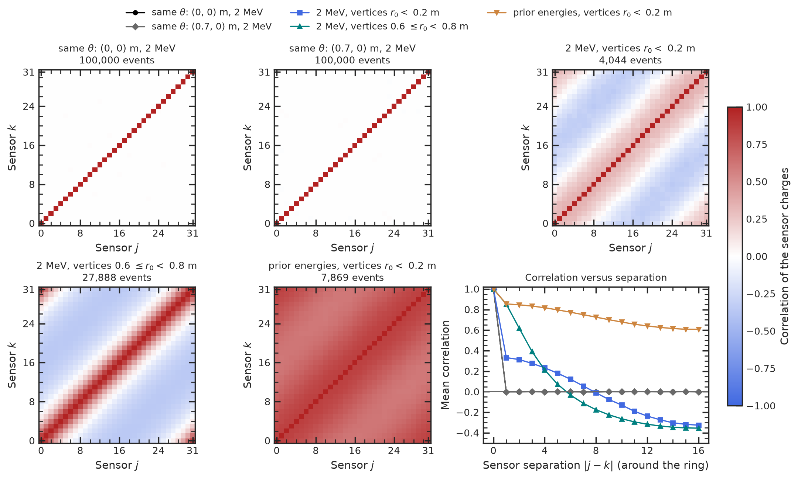
### 5. Correlations

For the same θ simulated 100 000 times (at the centre or at (0.7, 0) m) the sensors are
uncorrelated: mean off-diagonal correlation 0.0000 and -0.0001, largest |value| 0.012 and 0.010, which is what pure
noise gives for 496 pairs (r √N = 3.7 and 3.1; shuffled samples give a median of 3.2, permutation p = 0.10 and 0.72),
and every sensor has variance/mean = 0.99-1.01. With Poisson photon numbers every sensor charge is an independent
Poisson variable (Poisson thinning), so the likelihood factorises given θ. Correlations appear only when
θ varies: at 2 MeV with vertices r < 0.2 m neighbours correlate at +0.33 and opposite sensors at -0.33 (a dipole:
moving towards one side brightens it and dims the other), for 0.6 ≤ r < 0.8 m at +0.85 and -0.35, and with the prior
energies (r < 0.2 m) everything is positive (+0.61 to +0.85) because all sensors scale with E.

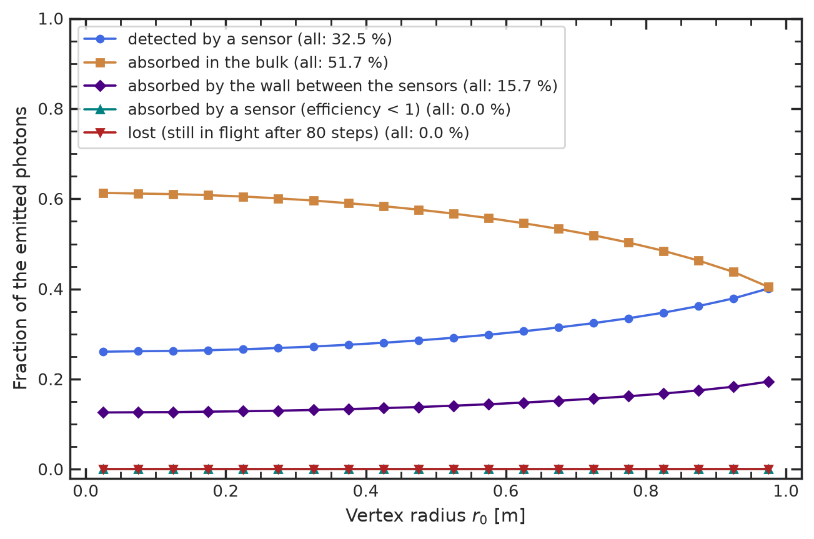
### 6. Photon fates

Over the disc 32.5 % of the photons are detected, 51.7 % are absorbed in the bulk, 15.7 % by the
bare wall, none by the sensors (efficiency 1) and none is lost (the 80-step limit is never reached). From the centre to
the wall bin the bulk absorption drops from 61.3 % to 40.5 % (shorter paths), while detection rises from 26.1 % to
40.1 % and wall absorption from 12.6 % to 19.4 %: more light reaches the wall when the vertex is close to it.

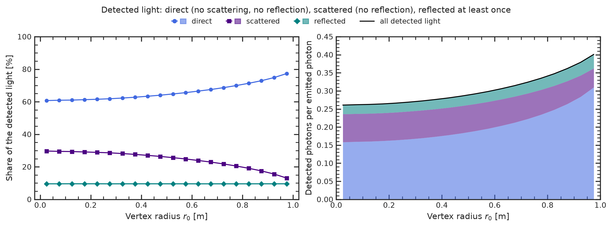
### 7. Composition

The direct share of the detected light is 60.8 % for vertices exactly at the centre, 69.3 %
averaged over the disc and 77.3 % in the wall bin; the scattered share falls from 29.7 % to 21.1 % and 13.1 %, and the
reflected share stays at 9.6 % everywhere (the seminar's "69 / 21 / 10 %" is the disc average, not the centre). A
plausible reason for the constant reflected share: a reflected photon restarts at the wall wherever it came from, and
on average the light reaching the wall meets sensors and bare wall in the ratio of the photocoverage. Per emitted
photon the rise of the collection from 0.26 to 0.40 is carried by the direct light (0.158 to 0.310), while the
scattered light even decreases (0.077 to 0.052).

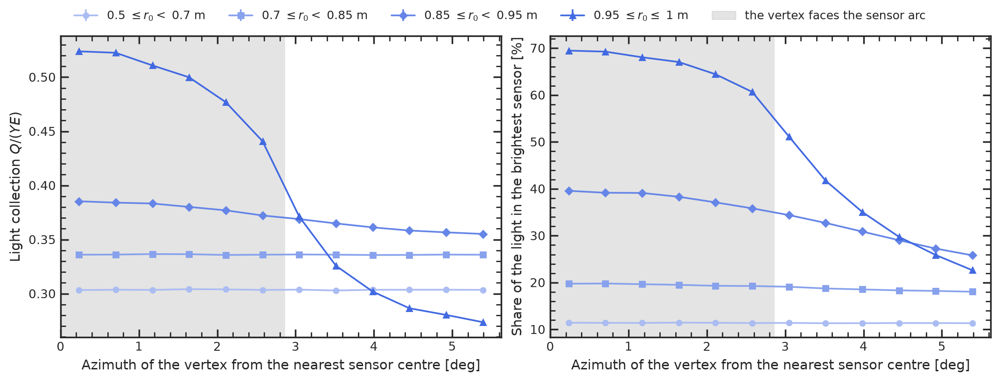
### 8. Azimuthal modulation (own)

For r ≥ 0.95 m the light collection is 0.524 when the vertex faces a sensor centre
and 0.274 when it faces the middle of a gap (a factor 1.9), and the brightest sensor holds 69 % versus 23 % of the
light; at 0.85-0.95 m the effect is 0.385 versus 0.355, and below 0.85 m it is gone (0.336 versus 0.336). Near the
wall the response is therefore a function of (x0, y0), not of r alone: no radial calibration is enough, and the
network needs the full charge pattern, which tells which sensor is nearest and how much light it got.

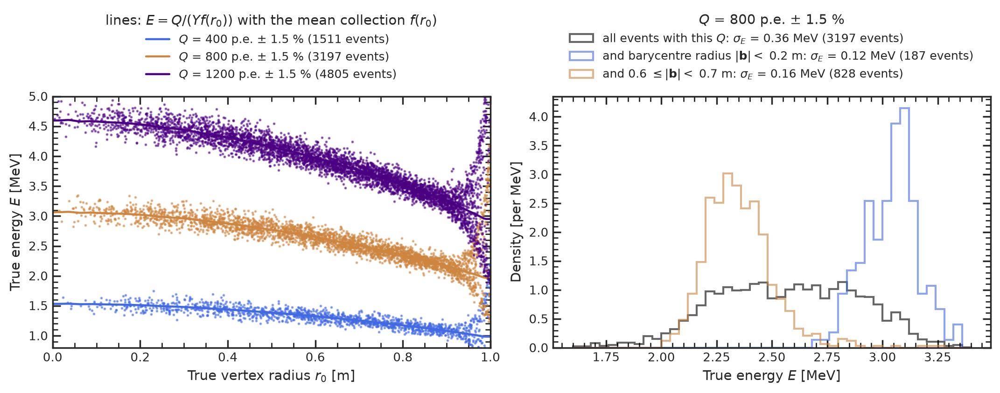
### 9. Energy-radius degeneracy (own)

Events with the same Q lie on the ridge E = Q/(Y f(r)): for Q = 800 ± 1.5 %
p.e. the true energies span 2.23-2.92 MeV (16-84 %, σ_E = 0.36 MeV; the ridge runs from 1.97 to 3.07 MeV). Adding
one pattern feature narrows it: with a barycentre radius |b| < 0.2 m the energy is 3.04 ± 0.12 MeV, with
0.6 ≤ |b| < 0.7 m it is 2.35 ± 0.16 MeV. This is the job of the posterior estimator: use the pattern to find the
point on the ridge; the selection itself is a crude posterior estimate (rejection ABC), as in T1.2.

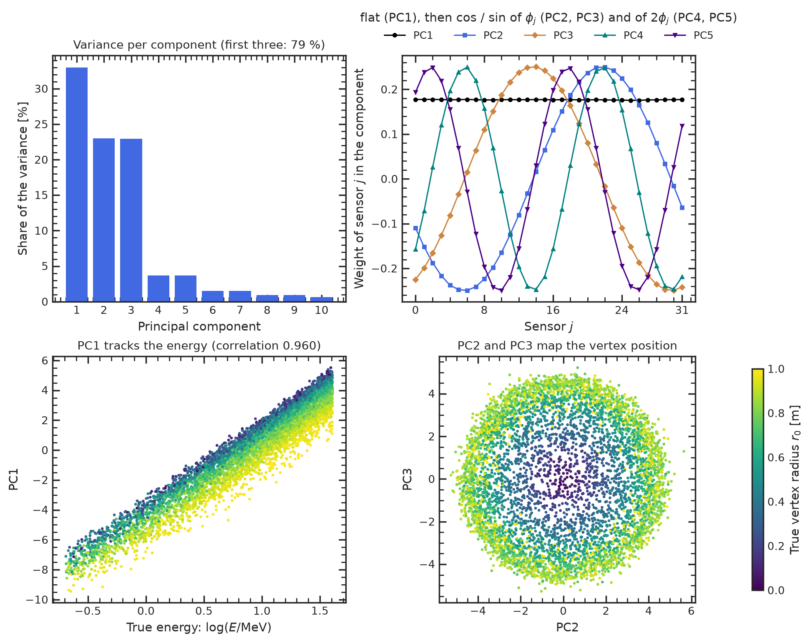
### 10. Principal components (own)

The 32 log charges are dominated by a few directions: PC1 (33.0 % of the variance)
has flat weights and correlates with log E at 0.960; PC2 and PC3 (23.0 % and 22.9 %) are the cosine and sine of the
sensor angle and map the vertex: the angle of (PC2, PC3) reproduces the true azimuth up to a rotation and mirror
(agreement 0.993) and its length correlates with r at 0.864; PC4 and PC5 (3.7 % each) are the cos 2φ / sin 2φ
patterns. Because the detector is rotationally symmetric the covariance of the sensors depends only on their
separation, so the components are Fourier modes of the ring. The first three components already hold 78.9 % of the
variance, so the input "knows" E and the vertex almost linearly; what the network must learn are the non-linear parts,
e.g. PC1 also depends on r (correlation -0.245: near-wall events concentrate their light and have a lower mean log
charge).

*Script:* `task2_proposals.py` (200 000 prior events, 100 000 events at E = 2 MeV, and 100 000 events each with the same θ at (0, 0) m and at (0.7, 0) m, 2 MeV). *Numbers:* `results/T2.json` under `T2.5`.

## T3.1 The physics ladder, configuration by configuration

Absorption is the process that costs light (0.509 → 0.307 of the emitted photons on average over
the disc) and makes the collection depend on the vertex; scattering changes the collected light very little but
widens the charge pattern and delays photons by about a nanosecond; reflection gives light back (+10.6 % in the full
model, +32.5 % alone) as a flat, late background. Straight light collects the photocoverage everywhere, and only the
jitter smears its times.

**Details**

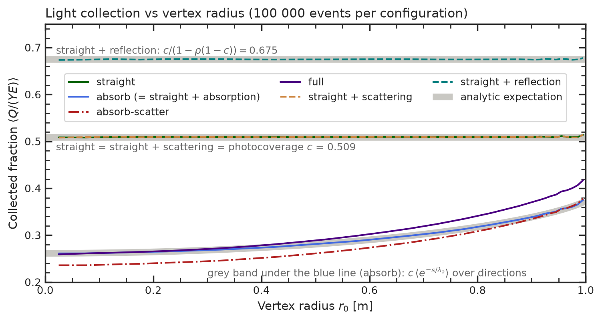
- **Light collection vs r0:** averaged over the azimuth, straight light and straight + scattering collect the
  photocoverage c = 0.509 at every radius (every photon reaches the wall, a fraction c of it is sensor; scattering only
  moves the hit points). Absorption lowers it to 0.261 at the centre (c e^(-R/λa) = 0.2615), rising to 0.375 in the
  last centimetre along the analytic c ⟨e^(-s/λa)⟩ over the directions (within the statistical errors); reflection
  alone lifts it to 0.675 = c/(1 − ρ(1 − c)) (the series of bounces); the full model rises from 0.259 to 0.417 (disc
  average 0.325).

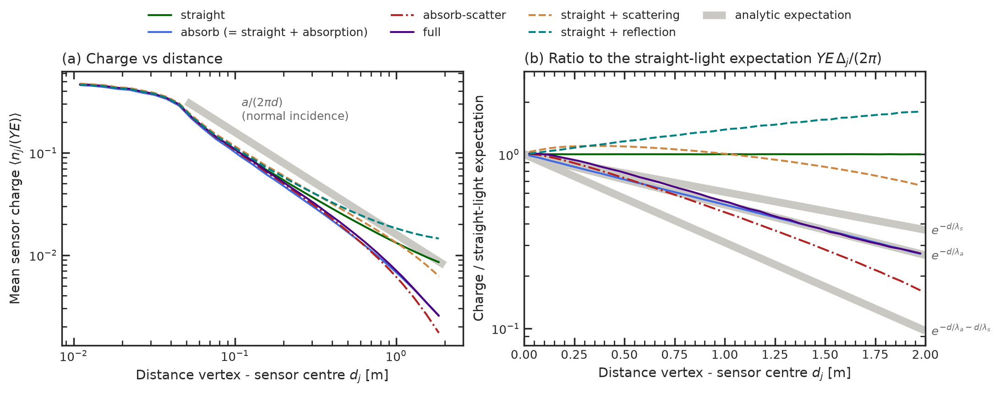
- **Charge vs distance:** in 2-D the light of a point source falls like 1/d (a/(2πd) for a sensor seen face on).
  Divided by the exact straight-light expectation Y E Δ_j/(2π) (T3.2) only the attenuation is left: a straight line on
  the log plot with a fitted length of 1.501 m for absorb (λa = 1.5 m), steeper with scattering (absorb-scatter
  1.06 m), and lifted at large distances by the almost uniform reflected light (straight + reflection: 1.76 times the
  geometric expectation at d ≈ 2 m).

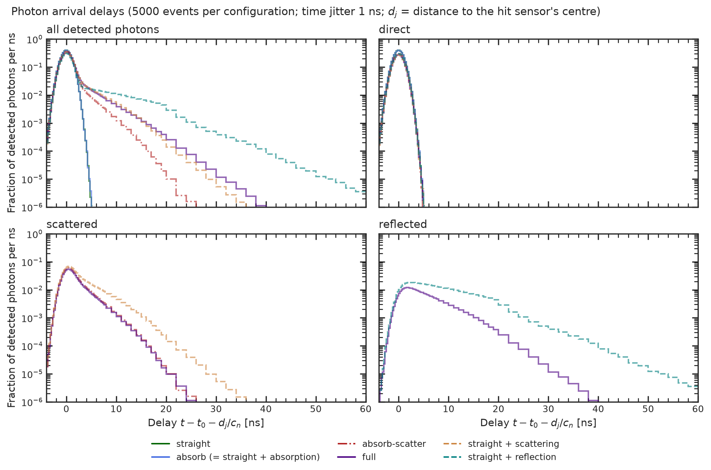
- **Delays t − t0 − d_j/c_n** (log scale): direct photons form the 1 ns jitter Gaussian (RMS 1.00 ns); scattered
  photons a tail with median 1.0-1.5 ns and 99 % below 11-15 ns; reflected photons arrive later (median 4.0 ns in the
  full model, 7.2 ns with reflection alone), with a kink at 20 ns = 4R/c_n, the longest single-bounce detour.

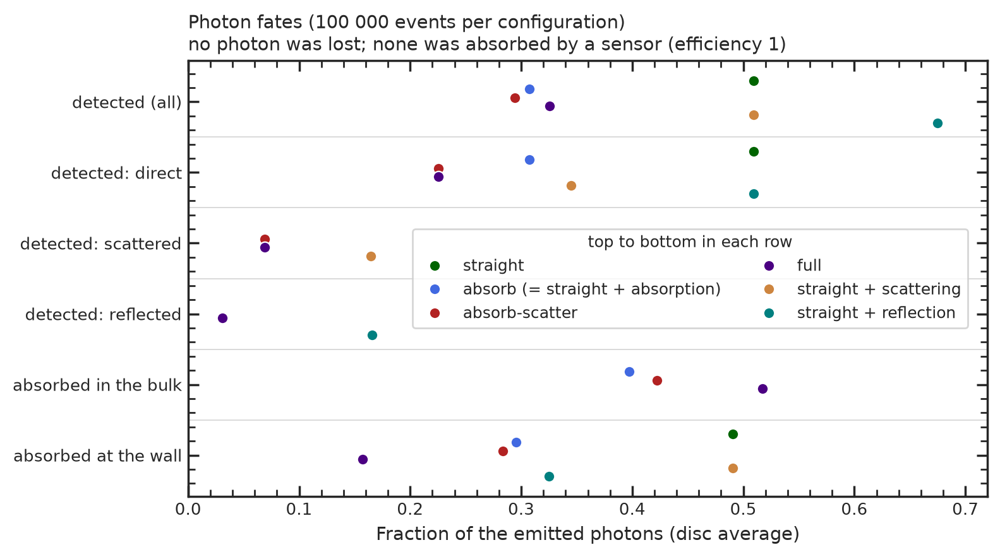
- **Fates:** straight light loses 49 % of the photons on the black wall between the sensors. In the full model 52 %
  die in the bulk, 16 % on the wall and 32.6 % are detected, 69.3 % of them direct, 21.1 % scattered and 9.5 %
  reflected (disc average; at the centre 60.8 / 29.6 / 9.6 %). No photon is lost or absorbed by a sensor in any
  configuration.

*Figures:* [`t3_1_light_collection`](figures/t3_1_light_collection.png), [`t3_1_charge_vs_distance`](figures/t3_1_charge_vs_distance.png), [`t3_1_delays`](figures/t3_1_delays.png), [`t3_1_photon_fates`](figures/t3_1_photon_fates.png) (`task3_1_ladder.py`;
100 000 prior events per configuration with the same seed, so all six see identical vertices, energies and photon
numbers; 5 000 events per configuration with hit lists for the delays). Styles are fixed in all T3 figures: the ladder
(straight dark green, absorb royal blue, absorb-scatter firebrick, full indigo) in solid lines, with absorb-scatter
dash-dotted; one process on top of straight light dashed (straight + scattering peru, straight + reflection teal);
analytic expectations as grey bands; the colour per preset is the same in T0.2 and T4.4.

## T3.2 Expected charge of a sensor: straight light and absorption

A photon flies straight to the wall, so sensor j catches exactly the photons emitted within the angle Δ_j under which its arc is seen from the vertex: ⟨n_j⟩ = ε Y E Δ_j / 2π. With absorption each direction is weighted by exp(−s(α)/λa) with s the distance to the wall. The simulation agrees with this over two orders of magnitude (χ²/ndf about 1 for every vertex and preset).

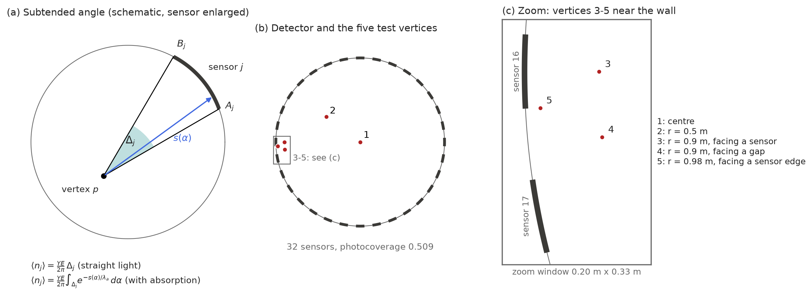
### Derivation, straight light

A photon leaves the vertex $\vec p = (x_0, y_0)$ in a direction $\alpha$ that is uniform
in $[0, 2\pi)$ and flies straight to the wall. The disc is convex and $\vec p$ lies inside, so the wall point that is hit
moves monotonically around the circle while $\alpha$ turns: the photons that end on sensor $j$ (arc from
$A_j = R(\cos\varphi_1, \sin\varphi_1)$ to $B_j = R(\cos\varphi_2, \sin\varphi_2)$, $\varphi_{1,2} = \varphi_j \mp a/(2R)$)
are exactly those emitted between the directions of $\vec u = A_j - \vec p$ and $\vec v = B_j - \vec p$. Each photon
therefore hits sensor $j$ with probability $\Delta_j / 2\pi$, where the subtended angle is

$$\Delta_j = \operatorname{atan2}\!\left(u_x v_y - u_y v_x,\; \vec u \cdot \vec v\right) \bmod 2\pi .$$

With $N \sim \mathrm{Poisson}(YE)$ independent photons, $n_j$ is again Poisson (thinning) with

$$\langle n_j \rangle = \varepsilon\, \frac{Y E}{2\pi}\, \Delta_j , \qquad \mathrm{Var}(n_j) = \langle n_j \rangle .$$

Far from the sensor ($d_j \gg a$), $\Delta_j \approx a \cos\beta_j / d_j$ with $\beta_j$ the angle between the ray and the
wall normal: in 2-D the light falls like $1/d$, not $1/d^2$. At the centre $\Delta_j = a/R = 0.1$ rad for every sensor,
so $\langle n_j \rangle = 31.83$ at 2 MeV and the 32 sensors together collect the photocoverage $c = 0.509$.

### With absorption

A photon emitted in direction $\hat u(\alpha)$ reaches the wall after
$s(\alpha) = -\vec p \cdot \hat u + \sqrt{(\vec p \cdot \hat u)^2 + R^2 - |\vec p|^2}$ and survives with probability
$e^{-s(\alpha)/\lambda_a}$, so

$$\langle n_j \rangle = \varepsilon\, \frac{Y E}{2\pi} \int_{\alpha_{A_j}}^{\alpha_{A_j} + \Delta_j} e^{-s(\alpha)/\lambda_a}\, d\alpha
\;\approx\; \varepsilon\, \frac{Y E}{2\pi}\, \Delta_j\, e^{-d_j/\lambda_a} ,$$

where $\alpha_{A_j}$ is the direction of $\vec u$ (equivalently, as an integral along the arc,
$d\alpha = R\,(R - \vec p \cdot \hat w)\, d\varphi / |\vec w - \vec p|^2$ with $\vec w = R \hat w$ the wall point). The
integral has no simple closed form for an off-centre vertex; it is done with 256-point Gauss-Legendre quadrature per
sensor (256 and 2048 nodes agree to 2.4e-15 relative). At
the centre $s = R$ and $\langle n_j \rangle = 31.83\, e^{-1/1.5} = 16.34$.

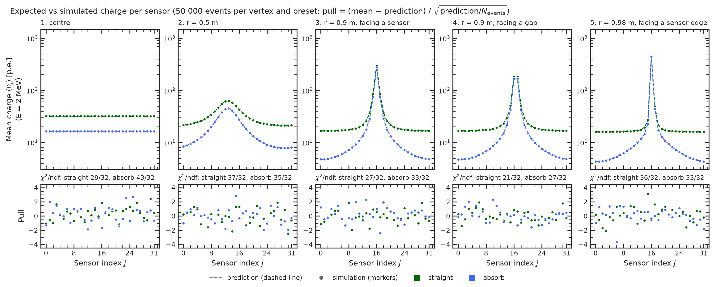
### Comparison

The simulated per-sensor means follow the predictions over two orders of magnitude, from 4.3 p.e. (far
sensors with absorption) to 452.5 p.e. (the sensor 2 cm in front of vertex 5: 452.46 simulated vs 452.51 predicted for
straight light, 442.27 vs 442.30 with absorption), and the simulated variance/mean of every sensor lies in
0.98-1.02 (Poisson). χ²/ndf over the 32 sensors (pull = (mean − prediction)/√(prediction/50 000)):

| vertex | straight χ²/32 (p) | absorb χ²/32 (p) | collected fraction straight, predicted / simulated | absorb |
|---|---|---|---|---|
| 1 centre | 29.3 (0.60) | 42.6 (0.10) | 0.5093 / 0.5094 | 0.2615 / 0.2616 |
| 2 r = 0.5 m | 36.5 (0.27) | 34.7 (0.34) | 0.5093 / 0.5092 | 0.2808 / 0.2808 |
| 3 r = 0.9 m, facing a sensor | 26.8 (0.73) | 32.5 (0.44) | 0.5202 / 0.5202 | 0.3491 / 0.3492 |
| 4 r = 0.9 m, facing a gap | 20.8 (0.94) | 26.8 (0.73) | 0.4984 / 0.4984 | 0.3279 / 0.3279 |
| 5 r = 0.98 m, facing a sensor edge | 36.2 (0.28) | 32.7 (0.43) | 0.5061 / 0.5062 | 0.3601 / 0.3601 |

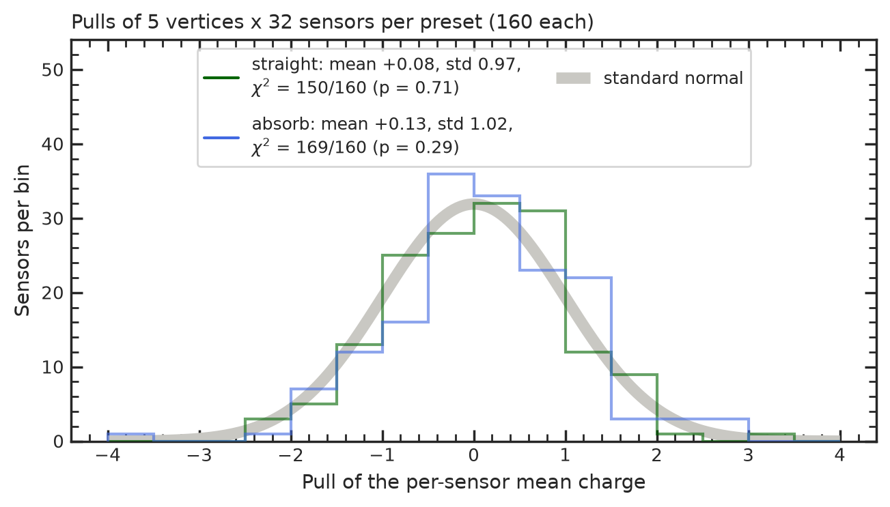
All 160 pulls per preset are consistent with a standard normal distribution: mean +0.08, standard deviation 0.97,
χ² = 150/160 (p = 0.71) for straight light and mean +0.13, standard deviation 1.02, χ² = 169/160 (p = 0.29) with
absorption (the two presets at one vertex share the seed, hence photon numbers and directions, so they are not pooled).
Point for the students: even for straight light the collected fraction depends on the vertex (0.520 facing a sensor vs
0.498 facing a gap at r = 0.9 m), but averaged over the azimuth it is c at every radius; absorption adds the real radial
dependence (0.2615 at the centre, 0.349 at vertex 3).

### The set-up of TASKS.md

(`results/T3.json`, key `T3.2/tasks_setup`): the two commands of the task sheet give 1000
events at (0.5, 0.2) m with exactly N = 2000 photons each (`--photon-statistics fixed`), so a student's per-sensor
means are directly comparable with these numbers. With a fixed N the charges are binomial rather than Poisson,
Var(n_j) = N p_j (1 − p_j): the measured variance/mean averaged over the sensors is 0.993 (straight) and 0.999 (absorb)
against 1 − p_j = 0.984 and 0.991 expected, an effect invisible at 1000 events. With the binomial variance in the
pulls, χ²/32 = 26.0 (p = 0.76) for straight light and 26.1 (p = 0.76) with absorption; the collected fraction is
0.5093 predicted / 0.5097 simulated and 0.2842 / 0.2842; the brightest sensor (j = 2) has 68.8 predicted / 68.7
simulated p.e. and 50.6 / 50.5 p.e. The approximation that the hint leads to, Y E Δ_j/(2π) exp(−d_j/λa) with d_j the
distance to the sensor centre, is exact for straight light and differs from the quadrature by at most 0.03 % at this
vertex (χ²/32 = 26.2); only within a few centimetres of a sensor does it fail: at vertex 5 (r = 0.98 m, 2 cm in front
of a sensor edge) it is 1.3 % low for the nearest sensor.

*Figures:* [`t3_2_subtended_angle`](figures/t3_2_subtended_angle.png) (definition and the five test vertices), [`t3_2_expected_charge`](figures/t3_2_expected_charge.png) (per-sensor mean charge
vs prediction and pulls), [`t3_2_pull_distribution`](figures/t3_2_pull_distribution.png) (`task3_2_expected_charge.py`; 50 000 events at E = 2 MeV for each
vertex and preset, fixed vertex and energy, Poisson photon numbers, detection efficiency ε = 1).

## T3.3 Which process does what?

Absorption changes the collected light most (−40 % relative to straight light). Reflection
destroys the timing information of the mean times: its photons arrive several nanoseconds late, whereas scattered
photons are only about a nanosecond late, and the first hit of a sensor survives both. The collection grows toward
the wall in the full model because photons from a vertex near the wall reach the nearby wall after a short path,
before they are absorbed or scattered; it is not the solid angle, which averaged over the azimuth is the
photocoverage at every radius (straight light does not grow).

**Details**

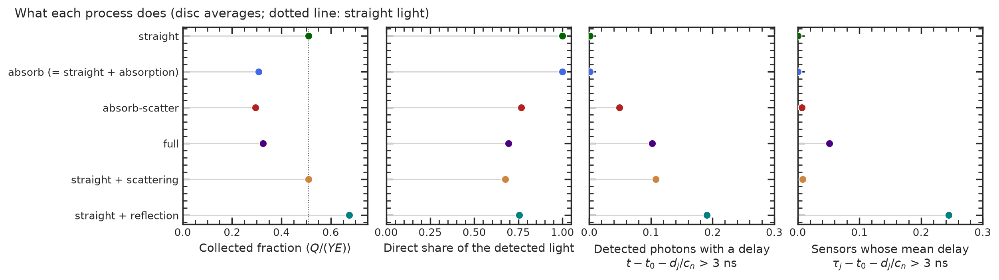
- **Collected light:** absorption −39.7 % relative to straight light; scattering alone −0.02 % (it only moves the hit
  points around the wall) and −4.1 % after absorption (longer paths, more absorption); reflection +32.5 % alone and
  +10.6 % on top of absorb-scatter.

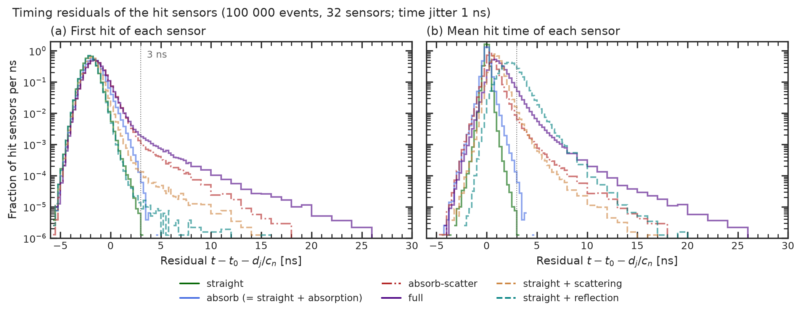
- **Timing:** scattering removes the most direct light (direct share 67.7 % with scattering alone vs 75.5 % with
  reflection alone, 69.3 % in the full model), but its photons are only 1.0-1.5 ns late (median, comparable to the
  1 ns jitter), whereas reflected photons are 4.0-7.2 ns late: with reflection alone 19.1 % of the photons and 24.5 %
  of the sensor mean times have a delay t − t0 − d_j/c_n above 3 ns (scattering alone: 10.8 % and 0.8 %; full: 10.2 %
  and 5.1 %). So reflection is what spoils the mean times the network will see. The first hit of a sensor survives
  both (residual RMS 0.62 ns for straight light, 1.03 ns in the full model; 68 % half-width 0.58-0.83 ns in every
  configuration; at most 0.44 % more than 3 ns late); it is biased early (median −2.0 ns for straight light) only
  because it is the earliest of n jittered photons.

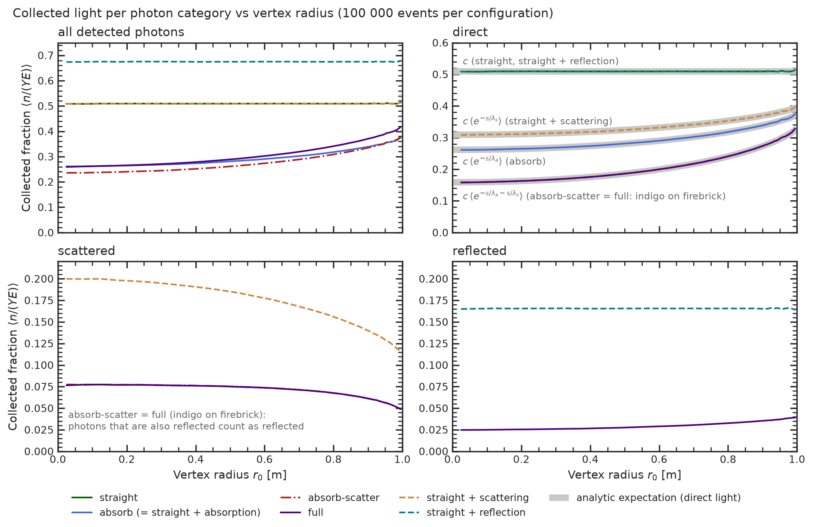
- **Growth toward the wall:** in the full model the collection rises by 0.158 from the centre to the last centimetre,
  driven by the direct light (+0.171, 0.158 → 0.329, on the analytic c ⟨e^(-s/λ)⟩ with 1/λ = 1/λa + 1/λs: 0.159 at the
  centre, 0.325 at r0 = 0.995 m): near the wall about half of the photons reach the nearby wall after a very short
  path without being absorbed or scattered. Reflected light adds a little (0.025 → 0.039, more photons reach the
  wall), scattered light falls (0.077 → 0.049, short paths scatter less), and straight light does not grow (0.509 →
  0.514, one standard error of 0.0045). It is the geometry of the path lengths combined with attenuation, not the
  solid angle.

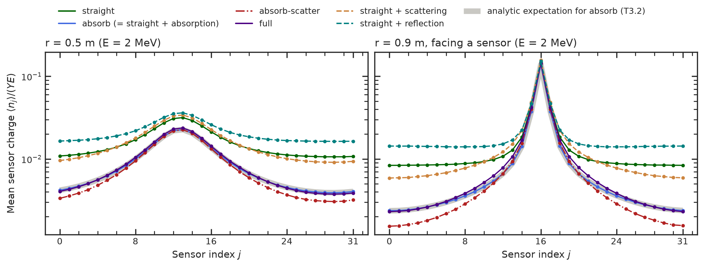
- **Charge pattern:** absorption and scattering sharpen it and reflection flattens it (max/min sensor charge at
  r0 = 0.9 m facing a sensor: 17.8 straight, 58.8 absorb, 93.3 absorb-scatter, 63.0 full, 10.9 straight + reflection).

*Figures:* [`t3_3_process_effects`](figures/t3_3_process_effects.png) (one row per configuration), [`t3_3_collection_by_category`](figures/t3_3_collection_by_category.png), [`t3_3_timing_residuals`](figures/t3_3_timing_residuals.png),
[`t3_3_charge_pattern`](figures/t3_3_charge_pattern.png); also [`t3_1_light_collection`](figures/t3_1_light_collection.png) and [`t3_1_delays`](figures/t3_1_delays.png) (`task3_3_processes.py`).

## T3.4 How hard is the inverse problem?

Without absorption the energy from Q with one constant is unbiased everywhere except in the last
centimetre, and its resolution is the photon statistics (about 3 %); absorption and scattering make the collected
light depend on the vertex, so the same constant reads the energy 13-18 % too low at the centre and 42-49 % too high
in the last centimetre (full model: −18 % to +45 %). The charge barycentre points in the right direction but is
pulled toward the centre by a factor that depends on the optics (0.50 r0 for straight light, 0.86 r0 in the full
model at r0 = 0.5 m), with an event-to-event spread of 2-3 cm inside r0 < 0.9 m and 15-25 cm next to the wall. A
learned posterior therefore needs the vertex from the whole charge pattern to undo the position dependence of the
collection, and the timing as independent information on the distances.

**Details**

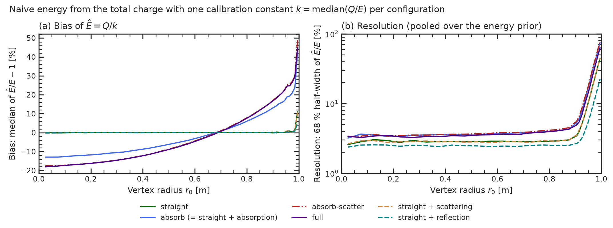
- **Energy, calibration:** k = 509 / 300 / 286 / 317 / 509 / 675 p.e. per MeV (k/Y = 0.509 / 0.300 / 0.286 / 0.317 /
  0.509 / 0.675; the mean-based constants are 2-3 % larger with absorption: 307 / 294 / 325 p.e. per MeV, because the
  distribution of Q/E is skewed toward the bright near-wall events).
- **Energy, bias vs r0:** without absorption the median bias is within 0.2 % for r0 < 0.9 m, but +0.8 / +0.9 / +0.5 %
  at r0 = 0.95-0.96 m and +11.0 / +10.7 / +5.1 % in the last centimetre, where Q/(YE) is bimodal (the vertex faces a
  sensor or a gap, T2.5 item 8), so the median sits on the sensor-facing mode while the mean stays unbiased
  (+0.9 / +1.0 / +0.4 %); with absorption the bias runs from −12.9 % (centre) to +42.1 % (last centimetre) for absorb,
  from −17.5 % to +48.9 % for absorb-scatter and from −18.1 % to +44.8 % for the full model (mean-based: −14.9 to
  +22.2 %, −19.8 to +28.5 %, −20.3 to +28.3 %: the last centimetre is where the two measures differ most). The bias
  crosses zero near r0 = 0.7 m. A calibration with a source at the centre instead would read +63 / +81 / +77 % at the
  wall for absorb / absorb-scatter / full.
- **Energy, resolution vs r0** (half of the central 68 %): 2.6-3.0 % for r0 < 0.9 m for straight light and straight +
  scattering, 2.4-2.6 % with reflection alone (more light), 3.2-4.5 % with absorption; it jumps to 12-21 % at
  r0 = 0.95-0.96 m and to 44.5 / 74.6 / 79.0 / 63.2 / 44.6 / 22.4 % in the last centimetre, where the collection
  depends on the azimuth of the vertex (the standard deviation per bin is about 10 % smaller than the 68 % half-width
  in the bulk and larger near the wall).

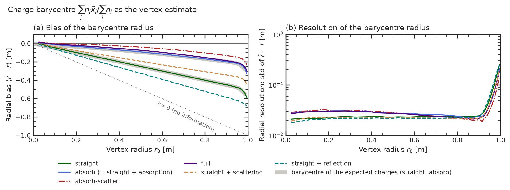
- **Vertex:** the barycentre is pulled toward the centre, analytically to r0/2 for straight light and to
  (1 + R/λa) r0/2 = 0.83 r0 with absorption at small r0 (the light density on the wall is (1 + (r0/R) cos θ)/(2π) times
  the attenuation); the simulated ⟨r̂⟩/r0 at r0 ≈ 0.5 m is 0.50 / 0.82 / 0.92 / 0.86 / 0.61 / 0.35 (attenuation
  sharpens the pattern, reflected light adds a flat background), with an event-to-event radial spread of 2-3 cm up to
  r0 = 0.9 m and 15-25 cm in the last centimetre.

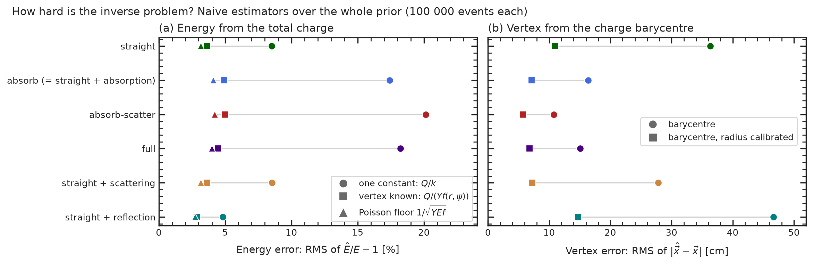
- **Summary** (RMS over the prior): the energy error of Q/k is 8.5 / 17.4 / 20.1 / 18.2 / 8.5 / 4.8 % but would be
  3.6 / 4.9 / 5.0 / 4.5 / 3.6 / 2.9 % with the vertex known (Poisson floor 2.8-4.2 %), and the barycentre misses by
  36 / 16 / 11 / 15 / 28 / 47 cm, still 11 / 7.1 / 5.7 / 6.8 / 7.2 / 14.7 cm after calibrating its radial response:
  the ladder is not uniformly harder, absorption makes the energy hard but the vertex easier, reflection does the
  opposite.
- **What a learned posterior needs beyond Q:** the vertex, read from the whole charge pattern, to undo the
  position-dependent collection (centre and wall differ by a factor 1.61 in the full model, so Q alone confuses E with
  r0); the full pattern rather than the biased barycentre, whose response depends on the optics and, for the 19 % of
  the events with r0 > 0.9 m, on the sensor granularity; and the timing: the relative mean times, which are the second
  half of the network input, carry the time of flight to each sensor plus the late scattered and reflected light that
  reflection adds (T3.3), and first hits would follow t0 + d_j/c_n up to a known, charge-dependent early offset
  (T2.5 item 2: the fitted slope is 5.98 ns/m, not the 5 ns/m of 1/c_n, because the bright near sensors have the
  earliest first hits). None of this is a closed formula in the full model, which is what the posterior has to learn
  from the simulation.

*Figures:* [`t3_4_energy_estimator`](figures/t3_4_energy_estimator.png), [`t3_4_barycentre`](figures/t3_4_barycentre.png), [`t3_4_inverse_problem`](figures/t3_4_inverse_problem.png) (summary) (`task3_4_naive_estimators.py`;
estimators applied to the 100 000-event main samples, calibrated on independent 50 000-event samples from the same
prior with another seed). The energy estimator follows the TASKS.md hint: one constant k = median of Q/E per
configuration, and in every bin of r0 the median of Ê/E − 1 as the bias and half of the central 68 % interval as the
resolution; the mean-based variants (k = ΣQ/ΣE, mean and standard deviation per bin) are stored next to them in
`results/T3.json` and quoted where they differ. Configurations below are always in the order straight / absorb /
absorb-scatter / full / straight + scattering / straight + reflection.

## T4.1 Event display

The display shows the disc with its 32 identical sensors coloured by their charge (black = no light, grey, green =
most light), the true vertex (gold star) and the charge barycentre Σ n_j s_j / Σ n_j, the naive vertex estimate (red
cross). The barycentre is always pulled towards the centre, because it averages sensor positions on the wall and even
the far side of the ring collects light; the pull grows with r.

**Details**

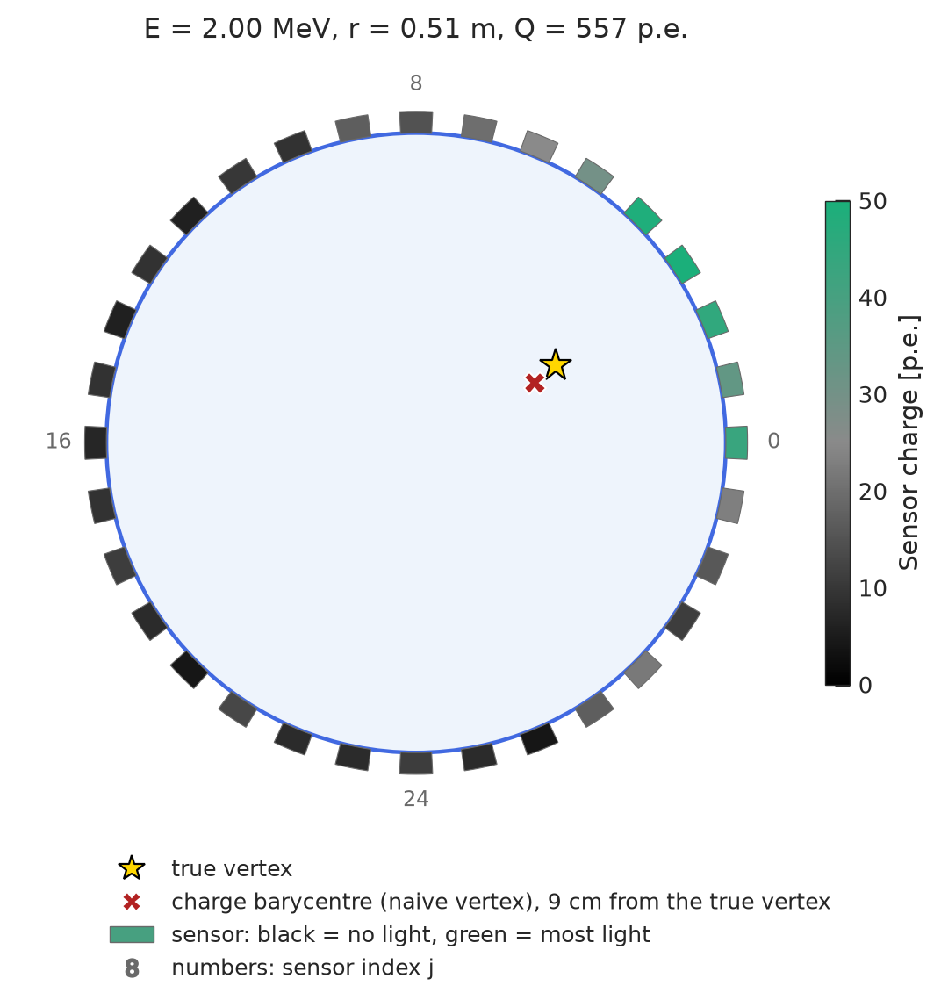
- *Main event* (E = 2.00 MeV, r = 0.51 m): 2083 emitted photons, Q = 557 p.e. (26.7 % collected); the brightest
  sensor (j = 3, 50 p.e.) faces the vertex; the barycentre sits at r = 0.43 m, 8.8 cm from the truth.

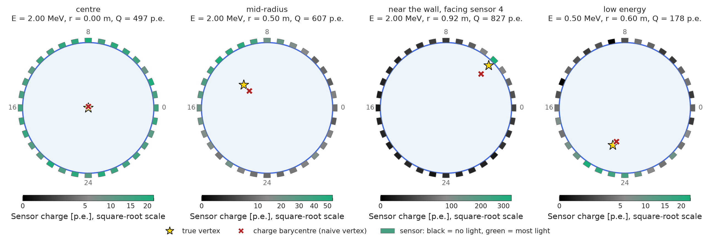
- *Gallery:* the pull is 2.0 cm at the centre (an almost uniform ring, Q = 497 p.e., brightest sensor 22 p.e.),
  12.5 cm at r = 0.50 m and 17.6 cm at r = 0.92 m, where the sensor facing the vertex alone collects 339 of the
  827 p.e. (41 %).
- The same 2 MeV gives more light near the wall (collected fraction 0.25 at the centre, 0.42 at r = 0.92 m in these
  single events); at the lowest energy of the prior (0.5 MeV, Q = 178 p.e.) two sensors are already empty.
- The gallery uses a square-root colour scale (stated on every colour bar) so that the dim sensors of the near-wall
  event remain visible next to the bright one.

*Figures:* [`t4_1_event_display`](figures/t4_1_event_display.png), [`t4_1_gallery`](figures/t4_1_gallery.png) (`task4_event_displays.py`, drawing helpers in `event_display.py`).
*Numbers:* `results/T4.json` under `T4.1`.

## T4.2 Event display with timing

The event of T4.1 (t0 = 3 ns) as a charge display, a time display (sensors coloured by the relative mean time, royal
blue = early, peru = late) and as charge (bars on the colour scale of the display), mean time and first time per
sensor. Both times follow the distance to the sensor, i.e. the time of flight d_j / c_n; relative times are used
because t0 is unknown: it shifts every τ_j and τ̄ alike and cancels in τ_j − τ̄, the second half of `network_input`.

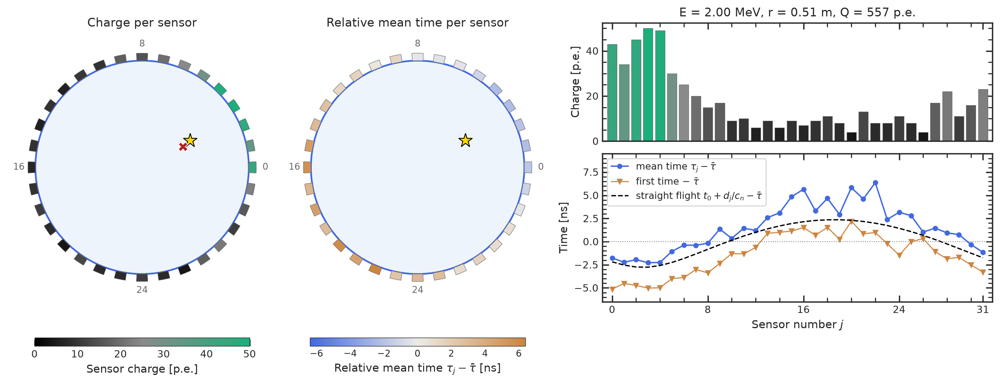
**Details**

- *Nearest sensor* (j = 3, 0.49 m from the vertex): 2.28 ns early on average, its first photon 5.02 ns early, relative
  to the charge-weighted mean time τ̄ = 8.21 ns. *Farthest sensor* (j = 19, 1.51 m): 2.94 ns late (mean time), 0.26 ns
  late (first time).
- *Correlation with d_j:* 0.94 for the mean times, 0.96 for the first times (dashed straight-flight curve).
- *First hits* arrive a median 1.6 ns (0.1 to 2.95 ns) before the straight-flight time to the sensor centre, because
  each is the earliest of many photons smeared by the 1 ns jitter; the mean times of the far sensors lie above the
  curve, as those sensors receive relatively more delayed, scattered and reflected light.

*Figure:* [`t4_2_timing`](figures/t4_2_timing.png) (`task4_event_displays.py`). *Numbers:* `results/T4.json` under `T4.2`.

## T4.3 Photon paths of one event

Of the 150 drawn photons of a 2 MeV event at r = 0.46 m, 39 are detected (peru, orange-brown, paths ending in a
diamond on a sensor), 90 are absorbed in the liquid (black crosses) and 21 by the wall between the sensors (black
triangles); along the paths there are 67 Rayleigh scatterings (indigo dots) and 16 wall reflections (teal squares).
Absorption dominates because the photons travel 0.86 m on average before their fate, not much less than λa = 1.5 m.

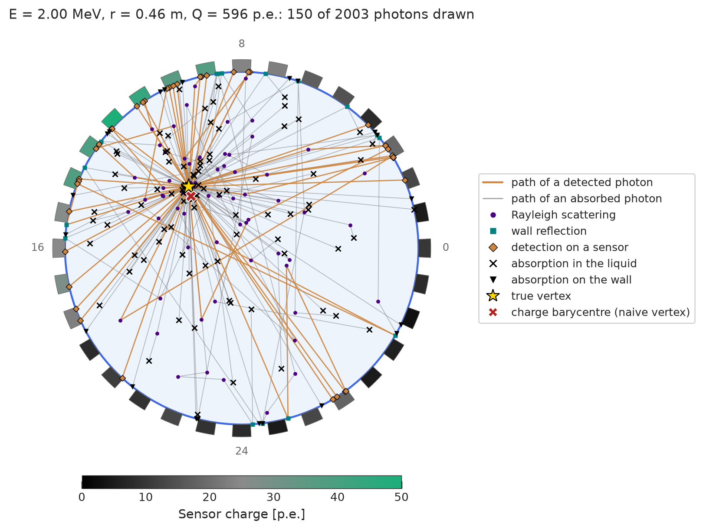
**Details**

- *Whole event:* 2003 photons emitted, Q = 596 p.e.: 29.8 % detected, 56.9 % absorbed in the liquid, 13.3 % absorbed
  by the wall, none lost; of the 596 detected photons 375 arrived directly, 160 after scattering and 61 after at least
  one reflection.
- *Path lengths:* mean 0.86 m, median 0.69 m before the fate.
- Scattering (λs = 2 m) kinks a minority of the paths; the reflections send light to sensors far from the vertex,
  which is why the far side of the ring is grey rather than black.
- Generated with `save_tracks=1, track_photons=150` (as `flashsim generate --save-tracks 1 --track-photons 150
  --fixed-vertex -0.3 0.35 --fixed-energy 2`); the paths are read back from `/tracks` of the HDF5 file.

*Figure:* [`t4_3_photon_paths`](figures/t4_3_photon_paths.png) (`task4_event_displays.py`). *Numbers:* `results/T4.json` under `T4.3`.

## T4.4 One theta, four presets

The same event (E = 2 MeV at r = 0.67 m) under the four presets: straight light collects 0.510 of the photons,
absorption reduces this to 0.299, scattering further to 0.284, and reflection gives some light back, 0.314.
Absorption sharpens the charge pattern (it punishes the long paths to the far side), reflection smooths it again; the
relative-time profiles keep the shape of the time of flight in every preset.

**Details** (`simulate(0.6, 0.3, 2.0, t0=0.0, config=preset(name), seed=10, save_tracks=1)`, the example call of
TASKS.md; profiles from 2000 events per preset)

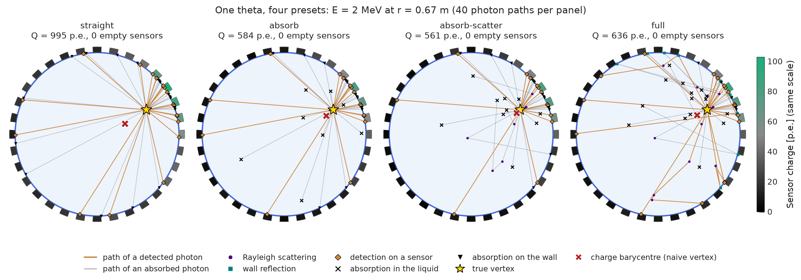
- *Collected light:* Q = 1019.5 p.e. on average for straight light (spread 33.3 p.e. over the events), 597.4 p.e. with
  absorption, 567.7 p.e. with absorb-scatter, 627.6 p.e. in the full model (67.4 % of it direct, 23.0 % scattered,
  9.6 % reflected).
- *Straight light and the photocoverage:* from this vertex the sensor arcs together subtend 0.50930 of the full angle
  (the T3.2 formula), the photocoverage itself. That is no coincidence: for isotropic emission the density of wall
  hits is the mean of the disc's Poisson kernel and the uniform density, and the sum over M equally spaced sensors
  keeps only the azimuthal harmonics of order kM, so the collected fraction differs from the photocoverage by
  (1/π) Σ_k (r0/R)^(kM) sin(kMa/2R) cos(kM φ0)/k: −6e-7 here (r0 = 0.67 m, M = 32), but +0.0109 and −0.0109 at
  r0 = 0.9 m facing a sensor and a gap, the T3.2 results of 0.520 and 0.498 (`results/T4.json`,
  `T4.4_straight_light_harmonics`).
- *Pattern sharpness:* the ratio of the brightest to the dimmest mean sensor charge grows from 4.9 (straight) to 12.2
  (absorb) and 16.8 (absorb-scatter), and drops to 13.4 when reflections spread light around; the mean barycentre
  radius follows (true r = 0.67 m): 0.34 m for straight light, 0.54, 0.60 and 0.56 m for the other presets.

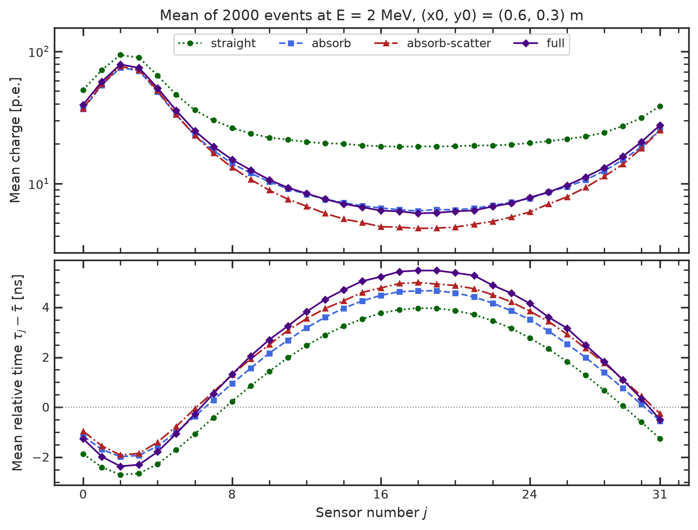
- *Times:* the vertical offsets of the relative-time profiles come from the reference τ̄ (the charge-weighted mean
  shifts when the near sensors gain weight); the late scattered and reflected light widens the range of the mean
  relative times from −2.7 ... +4.0 ns (straight) to −2.4 ... +5.5 ns (full).

*Figures:* [`t4_4_presets`](figures/t4_4_presets.png) (one event per preset with 40 of its recorded photon paths, the same colour scale for all
four), [`t4_4_profiles`](figures/t4_4_profiles.png) (mean charge and mean relative time per sensor) (`task4_event_displays.py`). *Numbers:*
`results/T4.json` under `T4.4`.

## T4.5 Animation (bonus)

A 0.3 MeV flash at (0.25, 0.15) m emits 280 photons, all of them recorded (`save_tracks=1, track_photons=None`). Each
frame advances by 0.12 ns of physical time: a photon's position follows from the path length stored at every track
point (t = s / c_n), scatterings (indigo dots) and wall reflections (teal squares) appear when they happen, absorbed
photons turn grey, and detected ones stay peru (orange-brown) and light up their sensor on the scale of the final
charges.

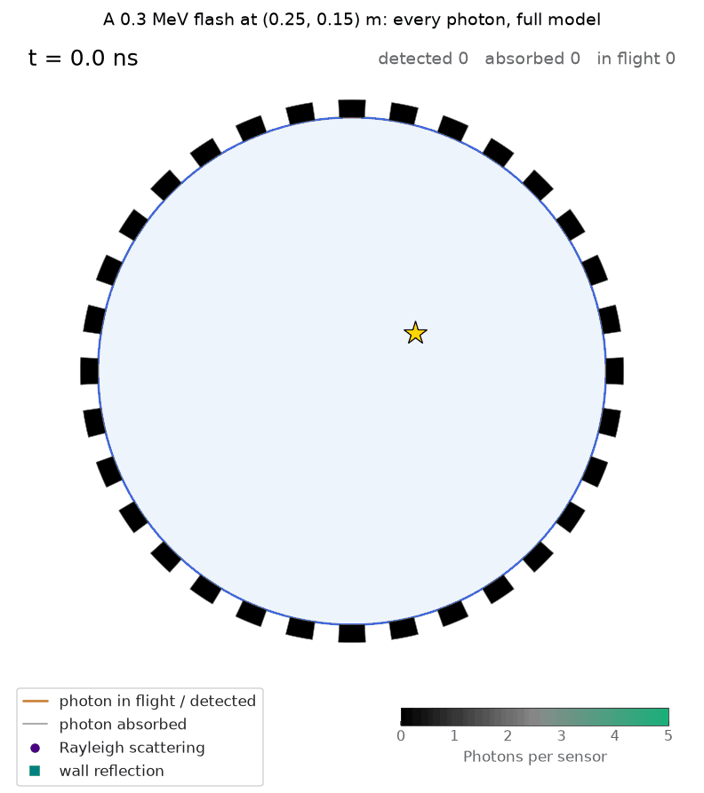
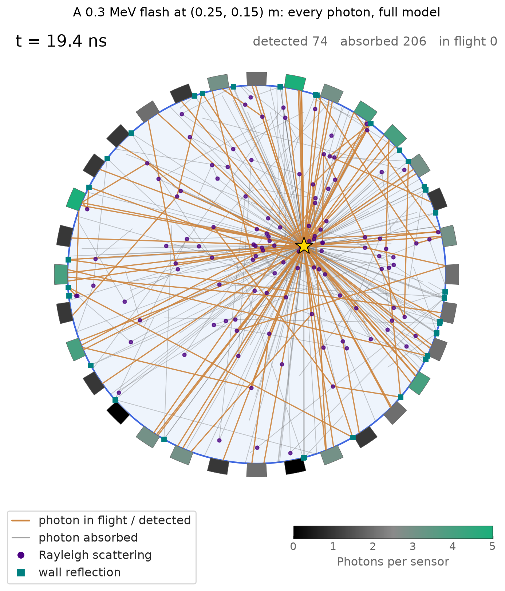
**Details**

- *Timeline:* the first photon is detected 3.54 ns after the emission; half of the detected ones arrive by 5.69 ns;
  half of all photons have ended by 4.11 ns (most of them absorbed); the last one ends at 19.41 ns, leaving 74
  detected, 206 absorbed and none in flight.
- *File size, a practical point:* written the plain way of the TASKS.md hint (`FuncAnimation` saved with
  `writer="pillow"`), the same flash at 800 px with 203 frames is 8.9 MB, because every frame gets its own colour
  palette; one shared palette without dithering keeps the 163-frame GIF at 1.0 MB. The 8.9 MB were measured once with
  `python solutions/stage1_flash/task4_animation.py --compare-pillowwriter`, which `run_all.sh` does not run.
- The same code makes the README animation `docs/img/flash_photons.gif` (`make_readme_figures.py`).

*Output:* `figures/t4_5_photons.gif` (792 x 894 px, 163 frames, an 8.1 s loop, 1.0 MB) and its last frame
[`t4_5_photons_frame`](figures/t4_5_photons_frame.png) (`task4_animation.py`, helper `photon_animation.py`, a port of the seminar's
`flash_animation.py`). *Numbers:* `results/T4.json` under `T4.5`.

## T5.1 The same theta many times (bonus)

With Poisson photon numbers every sensor charge is an independent Poisson variable ("Poisson splitting": if N is
Poisson and each photon ends on sensor j with probability p_j, the n_j are independent Poisson). With a fixed N the
counts are multinomial instead: Q is narrower and all sensor pairs are anti-correlated, because a photon that lands on
one sensor cannot land on another. The mean hit time of a sensor fluctuates as σ₁/√n; the first hit time does not.

**Details** (θ = (0.3, 0.4) m, r = 0.5 m, E = 2 MeV, 200 000 repetitions each with N ~ Poisson(Y E) and with
N = 2000 fixed)

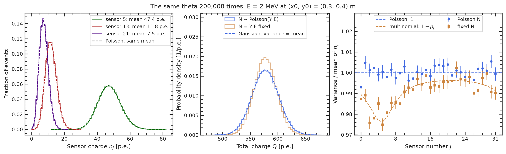
- *Poisson:* the histograms of the nearest sensor (j = 5, 0.50 m from the vertex, mean 47.4 p.e.), a side sensor
  (j = 13, 11.8 p.e.) and the farthest one (j = 21, 7.5 p.e.) lie on the Poisson probabilities; variance/mean is
  0.993-1.005 for all 32 sensors (rms pull 0.86); Q has variance/mean 1.000 ± 0.003; off-diagonal correlations
  −0.00004 with a spread of 0.0023, the 1/√N noise of 200 000 events.

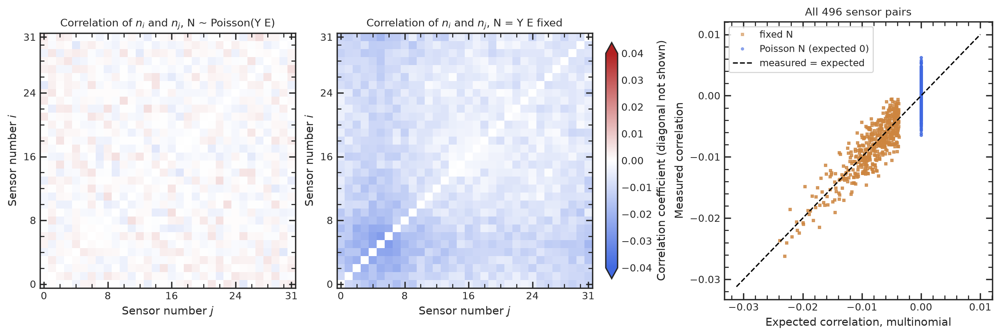
- *Fixed N (multinomial):* Q has variance/mean 0.710 (expected 1 − f = 0.711 with the collected fraction f = 0.289;
  spread 20.3 instead of 24.0 p.e.); each sensor has variance/mean 1 − p_j (nearest sensor 0.975 measured, 0.976
  expected; rms pull 1.04); all pairs are anti-correlated as −√(p_i p_j / ((1 − p_i)(1 − p_j))): −0.0083 on average vs
  −0.0082 expected, −0.024 to −0.026 for the brightest neighbours (j = 4, 5, 6; expected −0.023 to −0.024).
- *With the 20 000 events of TASKS.md* every pair correlation has a statistical noise of 1/√N = 0.007, as large as the
  effect: look at the average over the 496 pairs and at variance/mean of Q (0.71 instead of 1.00), which show it
  clearly at that sample size; the pair-by-pair agreement above needs the 200 000 events of the reference.

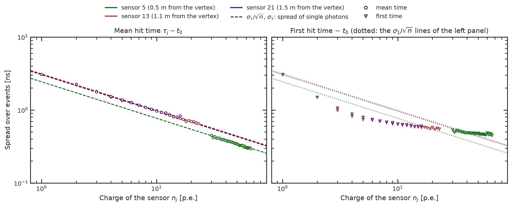
- *Times:* the mean hit time fluctuates as σ₁/√n with σ₁ the spread of single-photon arrival times (2.43 ns for the
  nearest sensor, 3.12 and 3.05 ns for the others): fitted exponents −0.515 ± 0.012, −0.501 ± 0.006, −0.499 ± 0.005.
  The spread of the first hit time falls much more slowly (0.45 ns at n = 66 against 0.30 ns for the mean time),
  because it is set by the 1 ns jitter of the earliest photon (T5.4: 0.44 ns with the jitter, 0.08 ns without).

*Figures:* [`t5_1_charge_distributions`](figures/t5_1_charge_distributions.png), [`t5_1_correlations`](figures/t5_1_correlations.png), [`t5_1_time_vs_charge`](figures/t5_1_time_vs_charge.png) (`task5_fluctuations.py`).
*Numbers:* `results/T5.json` under `T5.1`.

## T5.2 Degeneracy: the same mean Q from different (E, r) (bonus)

Q alone cannot tell the two events apart: both are Poisson with the same mean, the histograms coincide. The charge
pattern breaks the degeneracy (the barycentre radius separates them perfectly from r_B = 0.2 m on), and so does the
timing, because an off-centre vertex has near and far sensors. From Q alone the posterior would be a band along
E f(r) = const in the (r, E) plane; the pattern and the times collapse it, which the posterior network has to learn.

**Details**

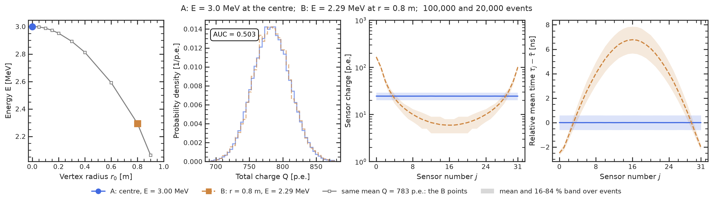
- *The pair:* event A at the centre with E = 3 MeV (light collection f(0) = 0.2609, mean Q = 782.6 p.e.); event B at
  radius r_B on the x axis with E_B = E_A f(0) / f(r_B), e.g. 2.295 MeV at r_B = 0.8 m where f = 0.341; the simulated
  mean charges agree to within 0.6 p.e. for every r_B (+0.27 ± 0.22 p.e. at 0.8 m).

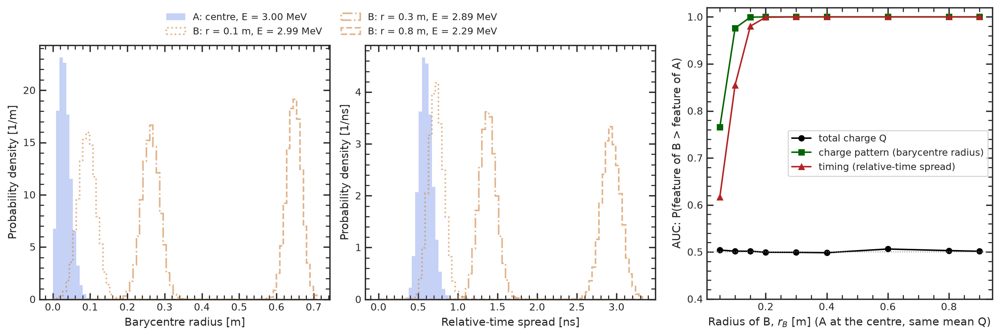
- *Q:* the AUC (probability that B has the larger value of the feature) is 0.498-0.506 for every r_B, with a
  statistical error of 0.002.
- *Charge pattern:* the barycentre radius has a median of 0.03 m for A and 0.65 m for B at 0.8 m; its AUC is 1.000
  from r_B = 0.2 m on, 0.976 at 0.1 m and still 0.77 at 0.05 m.
- *Timing:* the charge-weighted spread of the relative mean times has a median of 0.59 ns for A and 2.93 ns for B
  (AUC 0.62, 0.85 and 0.98 at r_B = 0.05, 0.1 and 0.15 m, at least 0.999 beyond).

*Figures:* [`t5_2_degeneracy`](figures/t5_2_degeneracy.png) (the pair with r_B = 0.8 m), [`t5_2_separation`](figures/t5_2_separation.png) (feature distributions and the scan in
r_B) (`task5_degeneracy.py`). *Numbers:* `results/T5.json` under `T5.2`.

## T5.3 Detector design (bonus)

At a fixed sensor width the light collection grows with the number of sensors (photocoverage 0.13 to 0.76 for M = 8
to 48) and the vertex resolution improves with the light, from 15.4 to 3.3 cm. At a fixed photocoverage the collected
light is the same for every M; the granularity matters mostly near the wall (37 cm to 6 cm in the last bin), while
below r = 0.8 m the four detectors are nearly equal and small sensors are more often empty.

**Details** (40 000 prior events per detector, the same events for all detectors)

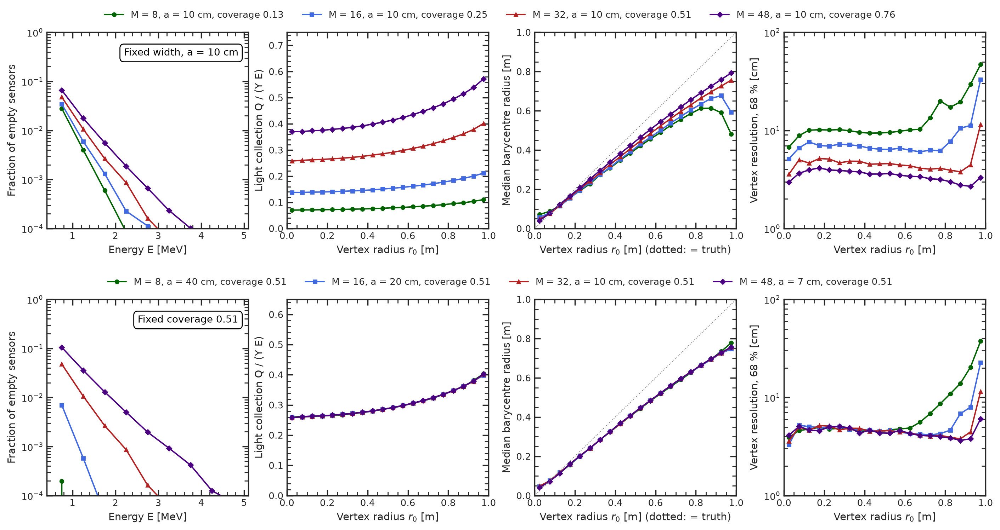
- *Fixed width 10 cm, M = 8, 16, 32, 48:* collection 0.089, 0.172, 0.326, 0.463 (coverage 0.13, 0.25, 0.51, 0.76);
  each sensor sees about the same light (30.4, 29.5, 27.9, 26.4 p.e.; slightly less at high coverage because less
  reflecting wall is left: the reflected share of the detected light falls from 16.7 % to 4.6 %); empty sensors
  0.37-1.04 %; barycentre resolution (68 % containment after a radial calibration) 15.4, 7.9, 4.5, 3.3 cm.
- *Fixed coverage 0.51 (a = 40, 20, 10, 6.7 cm):* collection 0.325-0.326 for every M, shared by more sensors (111.5,
  55.7, 27.9, 18.6 p.e. each), so empty sensors become common with 48 small sensors (1.8 % overall, 10.5 % for E
  between 0.5 and 1 MeV); resolution 8.8, 5.5, 4.5, 4.3 cm overall, 5.6, 4.5, 4.4, 4.4 cm below r = 0.8 m, and 37.4,
  22.6, 11.5, 6.0 cm in the outermost bin (0.95-1 m), where a few wide sensors cannot locate a vertex that faces one of
  them.


- *Barycentre pull:* median barycentre radius / r at r = 0.5 m is 0.85 for every M at fixed coverage, 0.80 to 0.89 at
  fixed width (reflections lose importance).

*Figures:* [`t5_3_detector_design`](figures/t5_3_detector_design.png) (empty sensors vs E, light collection vs r, median barycentre radius vs r, vertex
resolution vs r; one row per series), [`t5_3_layouts`](figures/t5_3_layouts.png) (one event on every detector) (`task5_detector_design.py`).
*Numbers:* `results/T5.json` under `T5.3`.

## T5.4 Detector effects: which features suffer most? (bonus)

Time jitter hurts the first times most and leaves the charges untouched; a lower detection
efficiency hurts every feature through the photon statistics (resolutions grow like 1 / sqrt(epsilon)); dark noise
hurts the mean times (one random hit shifts the mean of a few photons by nanoseconds) and, at high rates, the first
times, while the charges and the energy from Q hardly change. The simplest check is the spread of a feature at a
fixed vertex ([`t5_4_feature_distributions`](figures/t5_4_feature_distributions.png)): with 3 ns jitter the relative first time of the nearest sensor at
r0 = 0.6 m spreads by 1.28 ns instead of 0.44 ns, and with 10^7 Hz of dark noise the mean time of the farthest sensor
by 6.41 ns instead of 1.31 ns.

**Details**


- **Measure.** The main figure uses the linear Fisher bound sigma = 1 / sqrt(I) with I = mu'^T Sigma^-1 mu' (mu' from
  events at the vertex shifted by +-5 cm, Sigma the covariance of the feature group; 20 000 + 2 x 10 000 events per
  vertex and direction, E = 2 MeV): the vertex resolution that an ideal linear fit of that feature group would reach.
  Its statistical error from 20 bootstrap resamplings (`sigma_cm_err` in the JSON) is below 0.1 cm for every group
  and setting, smaller than every difference quoted below. The simpler measures of the hint agree: the charge
  barycentre of T3.4 reaches 3.5 cm at r0 = 0.1 m, the same as the bound of the charges, and the energy resolution
  from Q is quoted per setting.
- **Default readout** (sigma_t = 1 ns, epsilon = 1, no noise): the charges give 3.5 cm at r0 = 0.1 m (2.4 cm at
  r0 = 0.6 m, radial), the relative mean times 3.0 (2.3) cm, the relative first times 2.4 (2.3) cm and the network
  input, charges and mean times together, 2.4 (1.9) cm.


- **Time jitter** leaves the charges untouched but hurts the first times most: their bound goes from 0.01 cm without
  jitter (in this toy the earliest direct photon is then an almost exact clock) to 2.4 cm at 1 ns and 5.1 cm at 3 ns,
  against 2.8, 3.0 and 4.1 cm for the mean times (spread of the relative first time of the nearest sensor at
  r0 = 0.6 m: 0.08, 0.44 and 1.28 ns).
- **Detection efficiency** hurts all features through the photon statistics: the charges go from 3.5 to 5.0 and
  7.3 cm for epsilon = 1, 0.5 and 0.25 (about 1 / sqrt(epsilon)), the energy resolution from Q from 4.4 to 6.2 and
  8.7 %, and empty sensors appear (8.0 % at r0 = 0.6 m for epsilon = 0.25).
- **Dark noise** hurts the times and spares the charges: with 0.31, 3.2 and 32 noise hits per event (10^5, 10^6 and
  10^7 Hz per sensor in the 100 ns window) the mean-time bound at r0 = 0.1 m goes from 3.0 to 3.2, 4.4 and 7.2 cm,
  because one hit at a random time in the window shifts the mean of a few photons by nanoseconds (farthest sensor:
  spread 1.31, 1.52, 2.76 and 6.41 ns; 0.36 %, 0.92 %, 4.7 % and 28 % of the events beyond 10 ns); the first times
  resist up to 10^6 Hz (2.4 to 3.0 cm) but reach 6.6 cm at 10^7 Hz, when a noise hit often comes before the first
  photon, while the charges stay at 3.5-3.6 cm and the energy resolution (noise pedestal subtracted) at 4.4-4.5 %.
  Noise hits have times uniform in the readout window and do not move with t0, so with dark noise the relative times
  are no longer independent of the unknown t0 (see the network-input section of docs/physics.md).

*Figures:* [`t5_4_detector_effects`](figures/t5_4_detector_effects.png) (vertex resolution from each feature group for every setting) and
[`t5_4_feature_distributions`](figures/t5_4_feature_distributions.png) (one feature per effect); script `task5_detector_effects.py`; numbers in
`results/T5.json` under `T5.4`. One effect is changed at a time with the same seed; the dark rates include the 10^6
and 10^7 Hz of TASKS.md.
